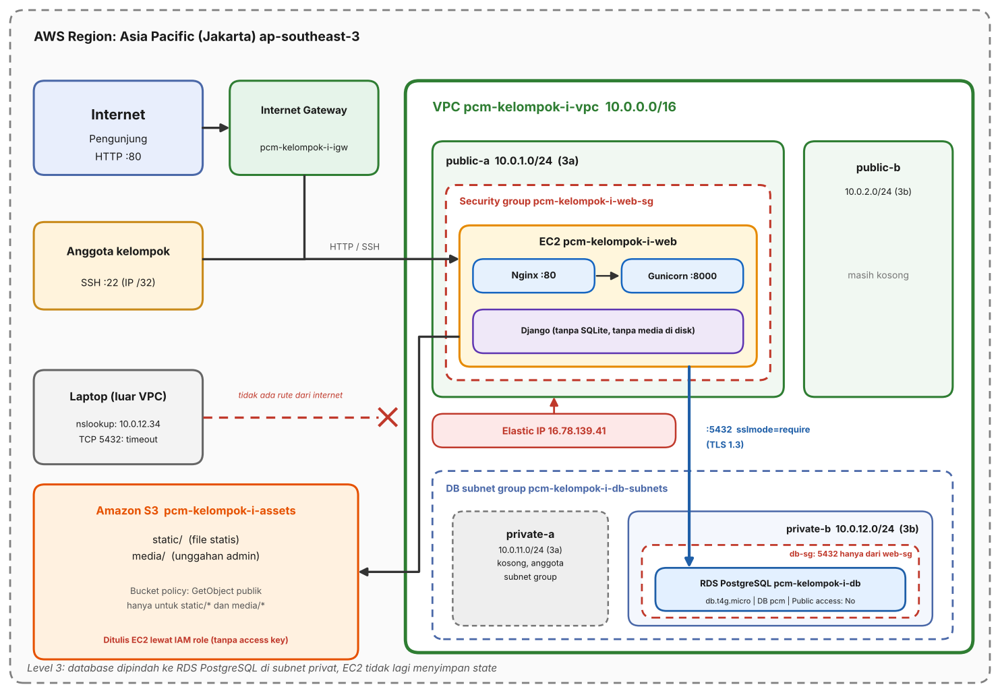

# Deploying a Django Website to AWS: VPC, EC2, S3, IAM, and RDS PostgreSQL

🇮🇩 **Versi Bahasa Indonesia:** [README.md](README.md)

A group project for the **Cloud Computing (TIF1344X)** course, Informatics Engineering, Universitas Muhammadiyah Surakarta (2026/2027).

We deployed an existing Django website, built for a local branch of the Muhammadiyah organization (PCM), to AWS in stages. The project starts with a single EC2 server and then moves its parts to managed AWS services until the server no longer stores any data.



## The Three Levels

| Level | Services | What we built | End state |
|---|---|---|---|
| 1 | VPC, EC2 | A custom VPC `10.0.0.0/16`, 2 public and 2 private subnets across 2 AZs, Internet Gateway, route tables, security group, and an EC2 instance running Nginx + Gunicorn + systemd | SQLite database and media files live on the EC2 disk |
| 2 | + S3, IAM | An S3 bucket for `static/` and `media/`, a restricted public-read bucket policy, and an IAM role for EC2 | Files in S3, database still SQLite |
| 3 | + RDS | RDS PostgreSQL in private subnets, chained security groups, and data migrated from SQLite | **EC2 holds no state**: files in S3, data in RDS |

All resources were created in the **Asia Pacific (Jakarta)** region, `ap-southeast-3`.

## Tech Stack

- **AWS:** VPC, Subnets, Internet Gateway, Route Tables, Security Groups, EC2, Elastic IP, S3, IAM Role, RDS for PostgreSQL
- **Server:** Ubuntu Server 24.04 LTS, Nginx, Gunicorn, systemd, Python 3.12 with `uv`
- **Application and data:** Django, SQLite (Levels 1 and 2), PostgreSQL 18.3 on RDS (Level 3)
- **Tooling:** AWS CLI, `psql`, OpenSSH, PowerShell

The Django application code was provided by the lecturer in the [assignment repository](https://github.com/tif1344/2026-tugas1-django-app-deployment-to-aws) and is **not part of this repository**. This repository focuses on network design, deployment, and infrastructure migration.

## Results and Evidence

| What it proves | Evidence |
|---|---|
| The website runs on RDS (the `/status/` page shows **Level 3 terdeteksi**, meaning "Level 3 detected") | [`evidence/level-3-rds/10_halaman-status-yang-menunjukkan-level-3-terdeteksi.png`](evidence/level-3-rds/10_halaman-status-yang-menunjukkan-level-3-terdeteksi.png) |
| RDS sits in private subnets with *Publicly accessible: No* | [`evidence/level-3-rds/05_detail-jaringan-rds-vpc-subnet-group-security.png`](evidence/level-3-rds/05_detail-jaringan-rds-vpc-subnet-group-security.png) |
| `db-sg` allows only port 5432 | [`evidence/level-3-rds/01_security-group-db-sg-dengan-satu-inbound.png`](evidence/level-3-rds/01_security-group-db-sg-dengan-satu-inbound.png) |
| The `psql` connection from EC2 uses TLS 1.3 (`sslmode=require`) | [`evidence/level-3-rds/06_koneksi-psql-dari-ec2-ke-rds-dengan.png`](evidence/level-3-rds/06_koneksi-psql-dari-ec2-ke-rds-dengan.png) |
| 19 tables and the old data (3 contact messages, the admin account) were migrated | [`evidence/level-3-rds/07_daftar-19-tabel-di-rds-setelah-migrate.png`](evidence/level-3-rds/07_daftar-19-tabel-di-rds-setelah-migrate.png), [`evidence/level-3-rds/08_query-di-rds-tiga-pesan-kontak-dan.png`](evidence/level-3-rds/08_query-di-rds-tiga-pesan-kontak-dan.png) |
| From a laptop outside the VPC, the database is unreachable | [`evidence/level-3-rds/13_dari-laptop-endpoint-rds-hanya-menghasilkan-ip.png`](evidence/level-3-rds/13_dari-laptop-endpoint-rds-hanya-menghasilkan-ip.png) |

All screenshots are indexed in [`evidence/`](evidence/README.md). The full report (in Indonesian) is at [`docs/Laporan_Tugas1_Level1-3_Kelompok_I.pdf`](docs/Laporan_Tugas1_Level1-3_Kelompok_I.pdf). Screenshot captions and the report are written in Indonesian.

## Design Decisions and Rationale

| Decision | Rationale |
|---|---|
| Private subnets created from Level 1 | RDS requires a DB subnet group with subnets in at least two Availability Zones. A subnet is "public" only because its route table points to the Internet Gateway |
| SSH (22) only from member IPs as `/32`, port 80 open to the public, port 8000 closed | Smaller attack surface. Gunicorn listens on `127.0.0.1` only and is reached through Nginx |
| App placed in `/srv/pcm-website` instead of `/home/ubuntu` | Nginx runs as `www-data` and cannot read home directories |
| IAM role for EC2, no access keys on the server or in `.env` | Temporary credentials come from the instance metadata service, so there is no long-lived key to leak |
| Role inline policy scoped to one bucket (`ListBucket` on the bucket, `Get/Put/DeleteObject` on its objects) | Least privilege |
| Bucket policy grants only `s3:GetObject` on `static/*` and `media/*`, with ACLs disabled | Visitors can open individual files but cannot list the bucket or write to it |
| RDS in private subnets, *Public access: No*, and `db-sg` uses `web-sg` as its source | The database has no path from the internet. A security-group-based rule keeps working if the server's IP changes or a second server is added |
| `sslmode=require` in `DATABASE_URL` | The application-to-database connection is encrypted (TLS 1.3 is visible in the `psql` output) |
| `DEBUG=false` and an explicit `ALLOWED_HOSTS` | Requests with an unknown Host header are rejected (visible in the logs as a 400 response) |
| No NAT Gateway | Not needed for this project and costs roughly USD 32 per month |

## What I Learned

- Plan AWS networking up front. Going from one server to a layered architecture was smooth because the subnets, route tables, and security groups were already prepared for the next level.
- Moving state out of the server (files to S3, data to RDS) means the EC2 instance can be replaced at any time without data loss. A fresh instance only needs the code, the `.env` file, the systemd service, the Nginx config, and the Elastic IP.
- The SQLite to PostgreSQL migration used `dumpdata` and `loaddata` with natural keys. Tables that `migrate` creates automatically (`contenttypes`, `auth.permission`, `sessions`, `admin.logentry`) were excluded from the dump to avoid conflicts.
- Debugging connection problems starts at the network layer (security groups, subnets, DNS), not in the application code.
- Cloud costs need managing from day one: set an AWS Budget, avoid NAT Gateways, release Elastic IPs, and delete resources after grading.

## Possible Next Steps (not done yet)

- HTTPS with a custom domain and Let's Encrypt (`certbot --nginx`)
- CloudFront in front of S3 with Origin Access Control, so the bucket is no longer public
- Closing port 22 and managing the server through SSM Session Manager
- An S3 Gateway VPC Endpoint so S3 traffic stays off the public internet
- CloudWatch alarms (EC2 CPU, RDS free storage) with email notifications
- Infrastructure as Code (Terraform or CloudFormation) so the whole architecture can be recreated with one command
- Narrowing IAM user permissions from `AdministratorAccess` to more specific policies

## Repository Structure

```
.
├── README.md                                      # Indonesian version
├── README.en.md                                   # English version
├── docs/
│   ├── Laporan_Tugas1_Level1-3_Kelompok_I.pdf     # full report (screenshots redacted)
│   ├── architecture/                              # Level 1, 2, and 3 architecture diagrams
│   └── social-preview.png                         # repository preview image for GitHub
└── evidence/
    ├── README.md                                  # index of all screenshots
    ├── level-1-vpc-ec2/
    ├── level-2-s3-iam/
    └── level-3-rds/
```

## Security and Privacy Notes

- This repository contains **no** `.pem` key pairs, `.env` files, passwords, `SECRET_KEY` values, or AWS access keys.
- AWS account IDs, the email addresses of contact form senders, and members' public IPs have been masked in the screenshots.
- AWS resources are deleted after grading as required by the assignment, so the addresses and endpoints shown in the images are no longer active.

## Team (Group I)

- Raden Bagus Indra Wijaya Nugraha
- Raka Aleksano Prugesta
- Fathkul Choiri
- Muhammad Afif Haravi
- Muhammad Nurrizal Ramadhani

Each member's contribution is listed in the contribution table in the report.

## References

- Amazon Web Services. [Working with a DB instance in a VPC](https://docs.aws.amazon.com/AmazonRDS/latest/UserGuide/USER_VPC.WorkingWithRDSInstanceinaVPC.html). Amazon RDS User Guide.
- Amazon Web Services. [Using SSL/TLS to encrypt a connection to a DB instance or cluster](https://docs.aws.amazon.com/AmazonRDS/latest/UserGuide/UsingWithRDS.SSL.html). Amazon RDS User Guide.
- Amazon Web Services. [Control traffic to your AWS resources using security groups](https://docs.aws.amazon.com/vpc/latest/userguide/vpc-security-groups.html). Amazon VPC User Guide.
- Django Software Foundation. [django-admin and manage.py](https://docs.djangoproject.com/en/stable/ref/django-admin/) (dumpdata, loaddata).
- Django Software Foundation. [Databases: PostgreSQL notes](https://docs.djangoproject.com/en/stable/ref/databases/#postgresql-notes).
- PostgreSQL Global Development Group. [SSL Support (libpq)](https://www.postgresql.org/docs/current/libpq-ssl.html).
