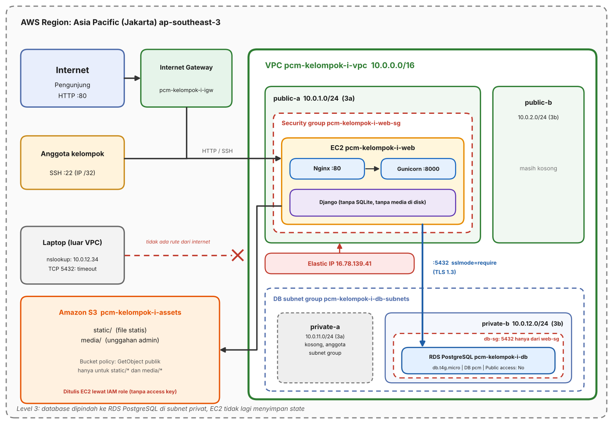

# Deploy Website Django ke AWS: VPC, EC2, S3, IAM, dan RDS PostgreSQL

🇬🇧 **English version:** [README.en.md](README.en.md)

Tugas kelompok mata kuliah **Cloud Computing**, Teknik Informatika, Universitas Muhammadiyah Surakarta (2026/2027).

Website Django milik sebuah Pimpinan Cabang Muhammadiyah (PCM) saya deploy ke AWS secara bertahap. Dimulai dari satu server EC2, lalu bagian-bagiannya dipindah ke layanan terkelola AWS sampai server tidak lagi menyimpan data apa pun.




## Ringkasan Tiga Level

| Level | Layanan | Yang dibangun | Kondisi akhir |
|---|---|---|---|
| 1 | VPC, EC2 | VPC `10.0.0.0/16` buatan sendiri, 2 subnet publik dan 2 subnet privat di 2 AZ, Internet Gateway, route table, security group, EC2 dengan Nginx + Gunicorn + systemd | SQLite dan file media ada di disk EC2 |
| 2 | + S3, IAM | Bucket S3 untuk `static/` dan `media/`, bucket policy baca-publik terbatas, IAM role untuk EC2 | File di S3, database masih SQLite |
| 3 | + RDS | RDS PostgreSQL di subnet privat, security group berantai, migrasi data dari SQLite | **EC2 tidak menyimpan state**: file di S3, data di RDS |

Semua resource dibuat di region **Asia Pacific (Jakarta)** `ap-southeast-3`.

## Teknologi

- **AWS:** VPC, Subnet, Internet Gateway, Route Table, Security Group, EC2, Elastic IP, S3, IAM Role, RDS for PostgreSQL
- **Server:** Ubuntu Server 24.04 LTS, Nginx, Gunicorn, systemd, Python 3.12 dengan `uv`
- **Aplikasi dan data:** Django, SQLite (Level 1 dan 2), PostgreSQL 18.3 di RDS (Level 3)
- **Alat bantu:** AWS CLI, `psql`, OpenSSH, PowerShell

Kode aplikasi Django disediakan oleh dosen di [repositori tugas](https://github.com/tif1344/2026-tugas1-django-app-deployment-to-aws) dan **bukan karya repositori ini**. Fokus repositori ini adalah perancangan jaringan, deployment, dan migrasi infrastruktur.

## Hasil dan Bukti

| Yang dibuktikan | Bukti |
|---|---|
| Website berjalan di atas RDS (halaman `/status/` menunjukkan **Level 3 terdeteksi**) | [`evidence/level-3-rds/10_halaman-status-yang-menunjukkan-level-3-terdeteksi.png`](evidence/level-3-rds/10_halaman-status-yang-menunjukkan-level-3-terdeteksi.png) |
| RDS berada di subnet privat dengan *Publicly accessible: No* | [`evidence/level-3-rds/05_detail-jaringan-rds-vpc-subnet-group-security.png`](evidence/level-3-rds/05_detail-jaringan-rds-vpc-subnet-group-security.png) |
| `db-sg` hanya mengizinkan port 5432 | [`evidence/level-3-rds/01_security-group-db-sg-dengan-satu-inbound.png`](evidence/level-3-rds/01_security-group-db-sg-dengan-satu-inbound.png) |
| Koneksi `psql` dari EC2 memakai TLS 1.3 (`sslmode=require`) | [`evidence/level-3-rds/06_koneksi-psql-dari-ec2-ke-rds-dengan.png`](evidence/level-3-rds/06_koneksi-psql-dari-ec2-ke-rds-dengan.png) |
| 19 tabel dan data lama (3 pesan kontak, akun admin) ikut pindah | [`evidence/level-3-rds/07_daftar-19-tabel-di-rds-setelah-migrate.png`](evidence/level-3-rds/07_daftar-19-tabel-di-rds-setelah-migrate.png), [`evidence/level-3-rds/08_query-di-rds-tiga-pesan-kontak-dan.png`](evidence/level-3-rds/08_query-di-rds-tiga-pesan-kontak-dan.png) |
| Dari laptop di luar VPC, database tidak bisa dijangkau | [`evidence/level-3-rds/13_dari-laptop-endpoint-rds-hanya-menghasilkan-ip.png`](evidence/level-3-rds/13_dari-laptop-endpoint-rds-hanya-menghasilkan-ip.png) |

Seluruh screenshot per level ada di [`evidence/`](evidence/README.md). Laporan lengkap: [`docs/Laporan_Tugas1_Level1-3_Kelompok_I.pdf`](docs/Laporan_Tugas1_Level1-3_Kelompok_I.pdf).

## Keputusan Desain dan Alasannya

| Keputusan | Alasan |
|---|---|
| Subnet privat sudah dibuat sejak Level 1 | RDS mensyaratkan DB subnet group dengan subnet di minimal dua Availability Zone. Subnet disebut publik hanya karena route table-nya mengarah ke Internet Gateway |
| SSH (22) hanya dari IP anggota dengan `/32`, port 80 untuk publik, port 8000 tertutup | Menekan permukaan serangan. Gunicorn hanya mendengarkan di `127.0.0.1` dan diakses lewat Nginx |
| Aplikasi diletakkan di `/srv/pcm-website`, bukan di `/home/ubuntu` | Nginx berjalan sebagai `www-data` dan tidak bisa membaca folder home |
| IAM role untuk EC2, tanpa access key di server atau `.env` | Kredensial sementara diambil dari instance metadata service, jadi tidak ada kunci permanen yang bisa bocor |
| Inline policy role dibatasi pada satu bucket (`ListBucket` pada bucket, `Get/Put/DeleteObject` pada objeknya) | Prinsip *least privilege* |
| Bucket policy hanya `s3:GetObject` untuk `static/*` dan `media/*`, ACL dinonaktifkan | Pengunjung bisa membuka file satuan tetapi tidak bisa melihat isi bucket atau menulis |
| RDS di subnet privat, *Public access: No*, dan `db-sg` memakai `web-sg` sebagai source | Database tidak punya jalur dari internet. Rule berbasis security group tetap berlaku walau IP server berganti atau server ditambah |
| `sslmode=require` pada `DATABASE_URL` | Koneksi aplikasi ke database terenkripsi (TLS 1.3 terlihat pada keluaran `psql`) |
| `DEBUG=false` dan `ALLOWED_HOSTS` diisi eksplisit | Request dengan header Host asing ditolak (terlihat pada log, kode 400) |
| Tidak memakai NAT Gateway | Tidak dibutuhkan untuk tugas ini dan biayanya sekitar USD 32 per bulan |

## Yang Saya Pelajari

- Jaringan AWS dirancang dari awal. Perubahan dari satu server menjadi arsitektur berlapis berjalan mulus karena subnet, route table, dan security group sudah disiapkan untuk level berikutnya.
- Memindahkan *state* (file ke S3, data ke RDS) membuat instance EC2 bisa diganti kapan saja tanpa kehilangan data. Yang perlu disiapkan untuk instance baru hanya kode, file `.env`, service systemd, konfigurasi Nginx, dan Elastic IP.
- Migrasi SQLite ke PostgreSQL memakai `dumpdata` dan `loaddata` dengan natural key, dan tabel yang dibuat otomatis oleh `migrate` (`contenttypes`, `auth.permission`, `sessions`, `admin.logentry`) dikecualikan dari dump agar tidak bentrok.
- Mendiagnosis masalah koneksi dimulai dari lapisan jaringan (security group, subnet, DNS), bukan dari kode aplikasi.
- Biaya cloud harus dikelola sejak awal: pasang AWS Budget, hindari NAT Gateway, lepas Elastic IP, dan hapus resource setelah penilaian.

## Ide Pengembangan Lanjutan (belum dikerjakan)

- HTTPS dengan domain sendiri dan Let's Encrypt (`certbot --nginx`)
- CloudFront di depan S3 dengan Origin Access Control, sehingga bucket tidak lagi publik
- Menutup port 22 dan mengelola server lewat SSM Session Manager
- S3 Gateway VPC Endpoint agar lalu lintas ke S3 tidak lewat internet
- CloudWatch alarm (CPU EC2, free storage RDS) dengan notifikasi email
- Infrastructure as Code (Terraform atau CloudFormation) supaya seluruh arsitektur bisa dibuat ulang dengan satu perintah
- Memecah izin IAM user dari `AdministratorAccess` menjadi izin yang lebih sempit

## Struktur Repositori

```
.
├── README.md                                      # versi Bahasa Indonesia
├── README.en.md                                   # English version
├── docs/
│   ├── Laporan_Tugas1_Level1-3_Kelompok_I.pdf   # laporan lengkap (screenshot sudah disamarkan)
│   ├── architecture/                              # diagram arsitektur Level 1, 2, dan 3
│   └── social-preview.png                         # gambar untuk pratinjau repo di GitHub
└── evidence/
    ├── README.md                                  # indeks seluruh screenshot
    ├── level-1-vpc-ec2/
    ├── level-2-s3-iam/
    └── level-3-rds/
```

## Catatan Keamanan dan Privasi

- Repositori ini **tidak berisi** key pair `.pem`, file `.env`, password, `SECRET_KEY`, maupun AWS access key.
- ID akun AWS, email pengirim pesan kontak, dan IP publik anggota pada screenshot sudah ditutup.
- Resource AWS dihapus setelah penilaian sesuai ketentuan tugas, sehingga alamat dan endpoint pada gambar tidak lagi aktif.

## Tim (Kelompok I)

- Raden Bagus Indra Wijaya Nugraha
- Raka Aleksano Prugesta
- Fathkul Choiri
- Muhammad Afif Haravi
- Muhammad Nurrizal Ramadhani

Pembagian tugas tiap anggota ada di tabel kontribusi pada laporan.

## Referensi

- Amazon Web Services. [Working with a DB instance in a VPC](https://docs.aws.amazon.com/AmazonRDS/latest/UserGuide/USER_VPC.WorkingWithRDSInstanceinaVPC.html). Amazon RDS User Guide.
- Amazon Web Services. [Using SSL/TLS to encrypt a connection to a DB instance or cluster](https://docs.aws.amazon.com/AmazonRDS/latest/UserGuide/UsingWithRDS.SSL.html). Amazon RDS User Guide.
- Amazon Web Services. [Control traffic to your AWS resources using security groups](https://docs.aws.amazon.com/vpc/latest/userguide/vpc-security-groups.html). Amazon VPC User Guide.
- Django Software Foundation. [django-admin and manage.py](https://docs.djangoproject.com/en/stable/ref/django-admin/) (dumpdata, loaddata).
- Django Software Foundation. [Databases: PostgreSQL notes](https://docs.djangoproject.com/en/stable/ref/databases/#postgresql-notes).
- PostgreSQL Global Development Group. [SSL Support (libpq)](https://www.postgresql.org/docs/current/libpq-ssl.html).
