# Level 1: VPC dan EC2

[← README](../README.md) · [README](../README.md) · [Galeri bukti](../evidence/README.md) · [Level 2 →](level-2-s3-iam.md)

> Satu server EC2 di VPC buatan sendiri. Nginx, Gunicorn, SQLite, dan file media berada di server yang sama. Halaman ini adalah salinan markdown dari [laporan PDF](Laporan_Tugas1_Level1-3_Kelompok_I.pdf), dengan screenshot yang datanya sudah disamarkan.

---

Tugas ini bertujuan men-deploy website Django milik Pimpinan Cabang Muhammadiyah (PCM) ke AWS. Pada Level 1, website dijalankan di satu instance EC2 yang berada di dalam VPC buatan sendiri. Nginx menerima request dan menyajikan file statis serta media dari disk, Gunicorn menjalankan aplikasi Django, dan database berupa file SQLite pada disk yang sama. Semua resource dibuat di region Asia Pacific (Jakarta) `ap-southeast-3` dengan nama yang memuat nama kelompok, yaitu `kelompok-i`.

## Tabel Kontribusi Anggota

| **No** | **Nama**                         | **Kontribusi**                                    |
|--------|----------------------------------|---------------------------------------------------|
| 1      | Raden Bagus Indra Wijaya Nugraha | Membuat Akun, Mengerjakan VPC dan EC2, Deployment |
| 2      | Raka Aleksano Prugesta           | Membuat Akun, Mengerjakan VPC, Membuat Laporan    |
| 3      | Fathkul Choiri                   | Mengerjakan VPC, Membuat Laporan                  |
| 4      | Muhammad Afif Haravi             | Mengerjakan VPC, EC2, Deployment, Membuat Laporan |
| 5      | Muhammad Nurrizal Ramadhani      | Membuat Akun, Mengerjakan VPC dan EC2             |

## Diagram Arsitektur

Gambar 1 menunjukkan arsitektur yang dibangun pada Level 1. Pengunjung mengakses website lewat Internet Gateway menuju Elastic IP milik instance EC2 di subnet `public-a`. Di dalam instance, Nginx pada port 80 meneruskan request dinamis ke Gunicorn di `127.0.0.1:8000`. Subnet `public-b`, `private-a`, dan `private-b` sudah disiapkan sejak awal karena RDS pada Level 3 membutuhkan subnet di minimal dua Availability Zone.

  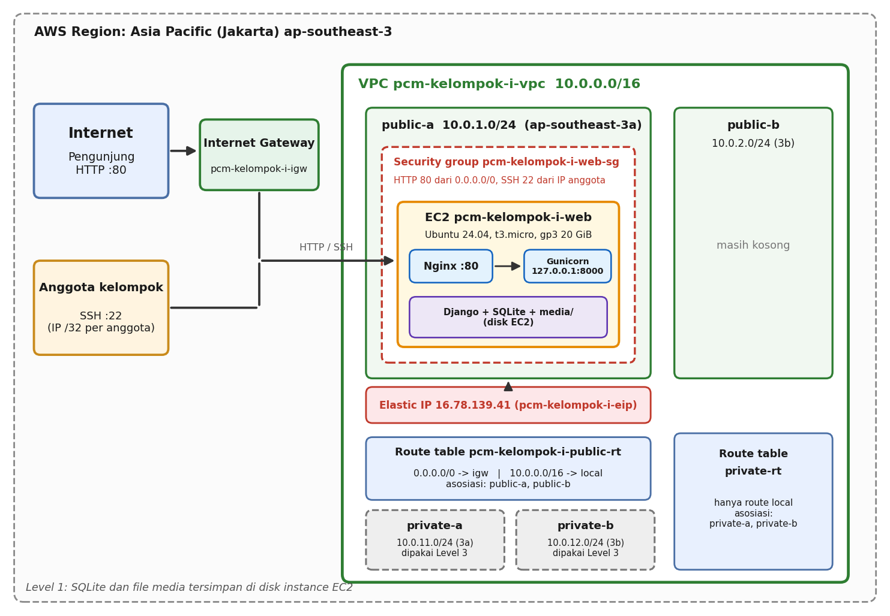 
  <em>Gambar 1: Diagram arsitektur Level 1 (VPC, subnet, EC2, Nginx, Gunicorn, SQLite).</em>

## Langkah 1: Persiapan Akun AWS dan IAM User

Kelompok memakai satu akun AWS Free Plan milik salah satu anggota. Pemilik akun mengaktifkan MFA pada root user, mengaktifkan region Asia Pacific (Jakarta), lalu membuat IAM user dengan akses konsol untuk setiap anggota. Hasilnya ada lima IAM user, yaitu `apip`, `fatkhul`, `indra`, `raka`, dan `rizal` (Gambar 1.1). Setiap user diberi policy `AdministratorAccess` karena akun ini khusus untuk tugas kelompok dan tidak ada access key yang dibuat. Setelah IAM user siap, root tidak dipakai lagi. AWS Budget bulanan sebesar USD 5 juga dipasang supaya biaya yang tidak terduga cepat diketahui.

  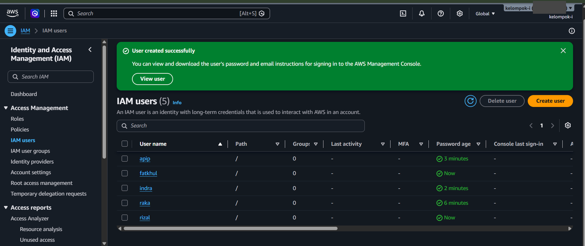 
  <em>Gambar 1.1: Daftar lima IAM user milik anggota kelompok.</em>

## Langkah 2: Membangun VPC, Subnet, Internet Gateway, dan Route Table

**a. VPC.** VPC dibuat manual lewat konsol VPC dengan opsi *VPC only*. Namanya `pcm-kelompok-i-vpc` dengan IPv4 CIDR `10.0.0.0/16` (Gambar 2.1). Setelah itu **DNS resolution** dan **DNS hostnames** diaktifkan melalui *Edit VPC settings* karena RDS pada Level 3 membutuhkannya (Gambar 2.2).

  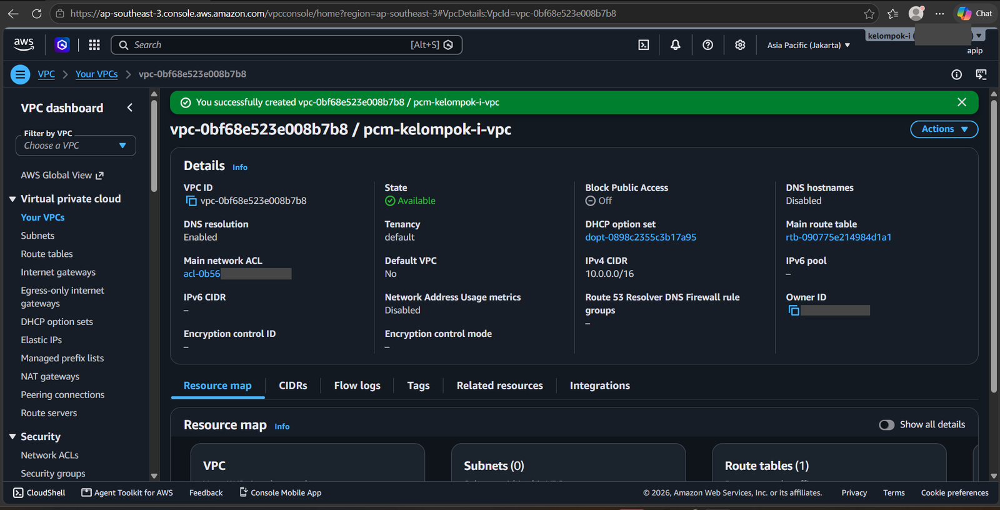 
  <em>Gambar 2.1: VPC pcm-kelompok-i-vpc berhasil dibuat.</em>

  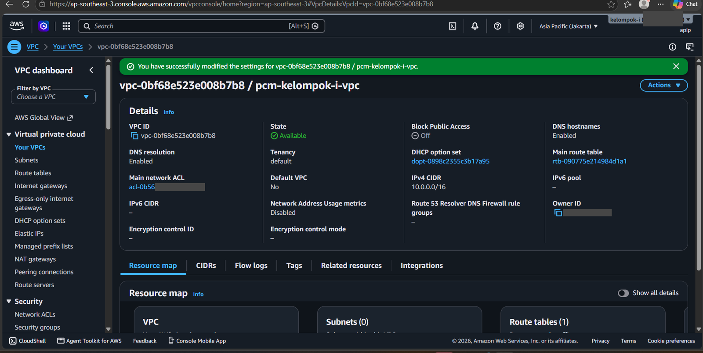 
  <em>Gambar 2.2: Pengaturan VPC setelah DNS resolution dan DNS hostnames diaktifkan.</em>

**b. Subnet.** Empat subnet dibuat pada dua Availability Zone seperti pada tabel berikut. Subnet publik dipakai oleh instance EC2, sedangkan subnet privat disiapkan untuk database RDS di Level 3 (Gambar 2.3).

| **Nama subnet**          | **Availability Zone** | **CIDR**     | **Jenis** |
|--------------------------|-----------------------|--------------|-----------|
| pcm-kelompok-i-public-a  | ap-southeast-3a       | 10.0.1.0/24  | Publik    |
| pcm-kelompok-i-public-b  | ap-southeast-3b       | 10.0.2.0/24  | Publik    |
| pcm-kelompok-i-private-a | ap-southeast-3a       | 10.0.11.0/24 | Privat    |
| pcm-kelompok-i-private-b | ap-southeast-3b       | 10.0.12.0/24 | Privat    |

  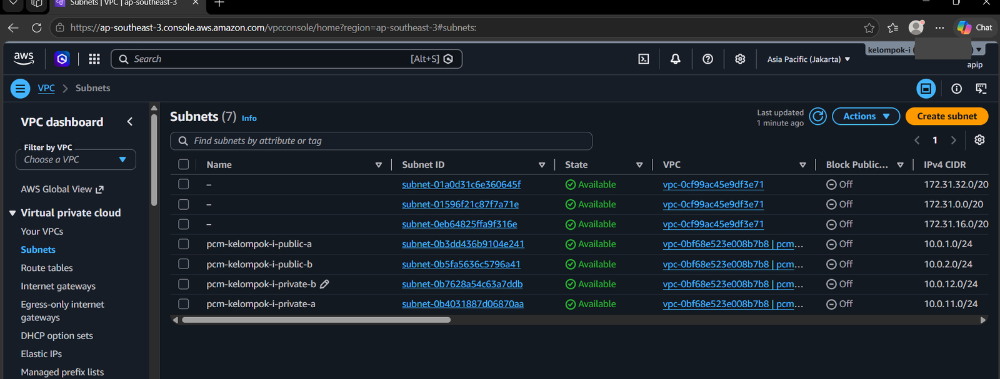 
  <em>Gambar 2.3: Daftar subnet, empat subnet pcm-kelompok-i dan tiga subnet bawaan VPC default.</em>

**c. Internet Gateway.** Internet Gateway `pcm-kelompok-i-igw` dibuat lalu di-attach ke `pcm-kelompok-i-vpc`. Statusnya berubah menjadi *Attached* (Gambar 2.4).

  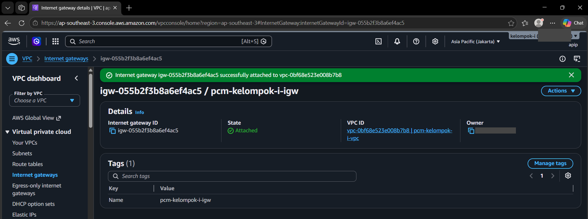 
  <em>Gambar 2.4: Internet Gateway pcm-kelompok-i-igw dengan status Attached.</em>

**d. Route table.** Dibuat dua route table. `pcm``-``kelompok``-``i``-public-rt` memiliki route `0.0.0.0/0` menuju Internet Gateway dan diasosiasikan ke `public-a` dan `public-b` (Gambar 2.5 dan 2.6). `pcm``-``kelompok``-``i``-private-rt` hanya memiliki route bawaan `local` dan diasosiasikan ke `private-a` dan `private-b` (Gambar 2.7 dan 2.8). Sebuah subnet disebut publik karena route table-nya mengarahkan `0.0.0.0/0` ke Internet Gateway, bukan karena namanya. Hubungan seluruh subnet, route table, dan Internet Gateway dapat dilihat pada resource map (Gambar 2.9).

  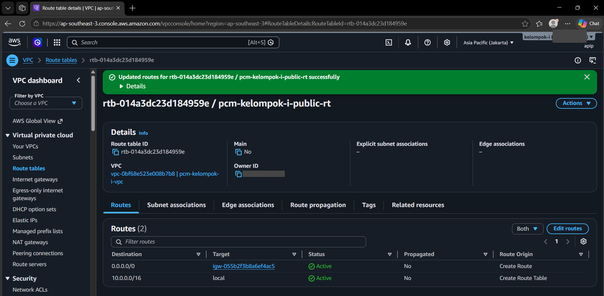 
  <em>Gambar 2.5: Route public-rt, 0.0.0.0/0 menuju igw dan 10.0.0.0/16 local.</em>

  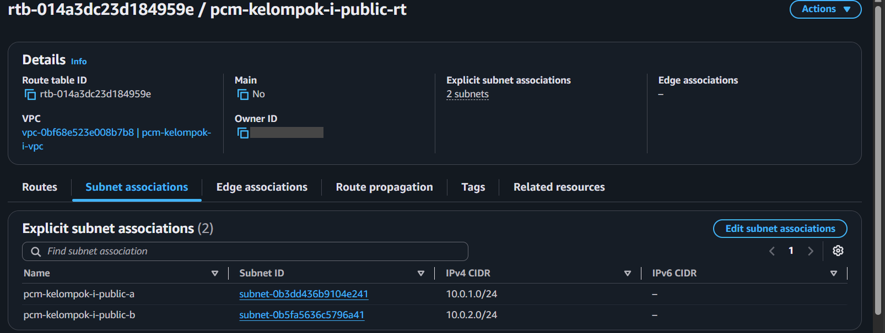 
  <em>Gambar 2.6: Subnet association public-rt, yaitu public-a dan public-b.</em>

  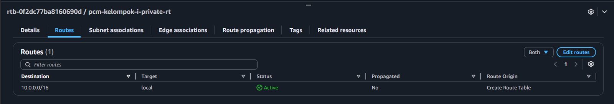 
  <em>Gambar 2.7: Route private-rt, hanya route local 10.0.0.0/16.</em>

  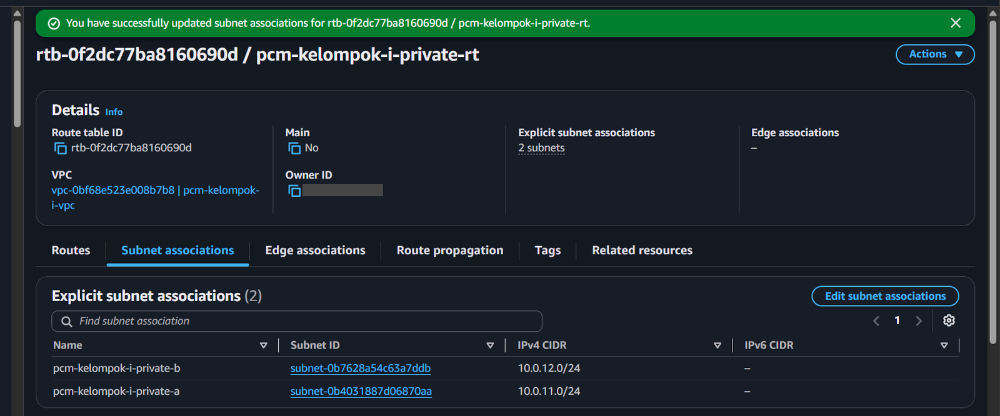 
  <em>Gambar 2.8: Subnet association private-rt, yaitu private-a dan private-b.</em>

  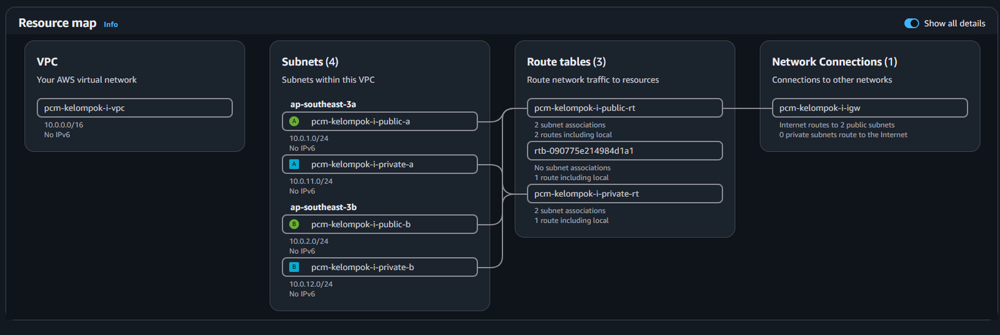 
  <em>Gambar 2.9: Resource map VPC pcm-kelompok-i-vpc.</em>

## Langkah 3: Konfigurasi Security Group

Security group `pcm``-``kelompok``-``i``-web-sg` dibuat di dalam `pcm-kelompok-i-vpc`. Inbound rules yang dipasang adalah HTTP port 80 dari `0.0.0.0/0` agar website bisa dibuka publik, dan SSH port 22 hanya dari IP publik anggota dengan akhiran `/32` (Gambar 3.1). Port 8000 tidak dibuka karena Gunicorn hanya diakses lewat Nginx. Outbound dibiarkan bawaan supaya server bisa mengunduh paket.

  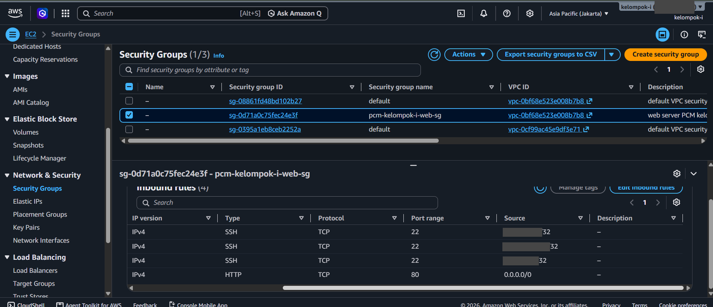 
  <em>Gambar 3.1: Inbound rules pcm-kelompok-i-web-sg (HTTP 80 dan SSH 22 dari IP anggota).</em>

## Langkah 4: Launch EC2 dan Elastic IP

Instance dibuat dengan nama `pcm``-``kelompok``-``i``-web`, AMI Ubuntu Server 24.04 LTS (x86), tipe `t``3.micro`, dan key pair `pcm``-``kelompok``-``i``-key` (.pem). Jaringannya memakai VPC `pcm-kelompok-i-vpc`, subnet `pcm``-``kelompok``-``i``-public-a`, auto-assign public IP aktif, dan security group `pcm``-``kelompok``-``i``-web-sg`. Storage yang dipakai 20 GiB gp3. Agar alamat tidak berubah saat instance di-stop, dialokasikan Elastic IP `pcm-kelompok-i-eip` lalu di-associate ke instance. Hasilnya Elastic IP **16.78.139.41** terhubung ke instance `i-07ec4ff3770bec377` (Gambar 4.1). Detail instance menunjukkan status Running, 3/3 status check passed, Availability Zone ap-southeast-3a, dan IP privat 10.0.1.67 (Gambar 4.2).

  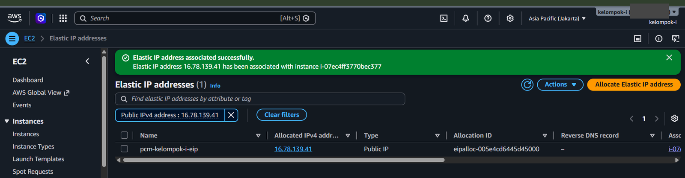 
  <em>Gambar 4.1: Elastic IP 16.78.139.41 berhasil di-associate ke instance EC2.</em>

  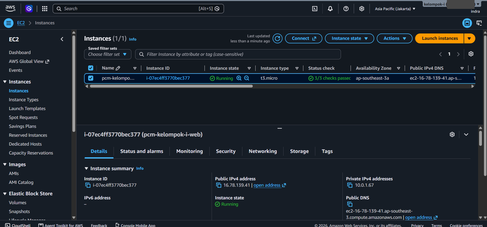 
  <em>Gambar 4.2: Detail instance pcm-kelompok-i-web, status Running dan 3/3 checks passed.</em>

## Langkah 5: Koneksi SSH ke Server

Koneksi dilakukan dari Windows PowerShell memakai OpenSSH bawaan. Karena perintah `chmod` tidak tersedia di Windows, izin file `.``pem` diatur dengan `icacls` (reset izin, putus pewarisan, lalu beri hak baca hanya untuk user sendiri). Setelah itu koneksi dibuka dengan `ssh -``i`` ``pcm-kelompok-i-key.pem`` ubuntu@16.78.139.41`. Prompt berubah menjadi `ubuntu@ip-10-0-1-67`. Alamat IP privat 10.0.1.67 berada pada rentang subnet `public-a` (10.0.1.0/24), jadi instance memang berada di subnet yang benar (Gambar 5.1).

  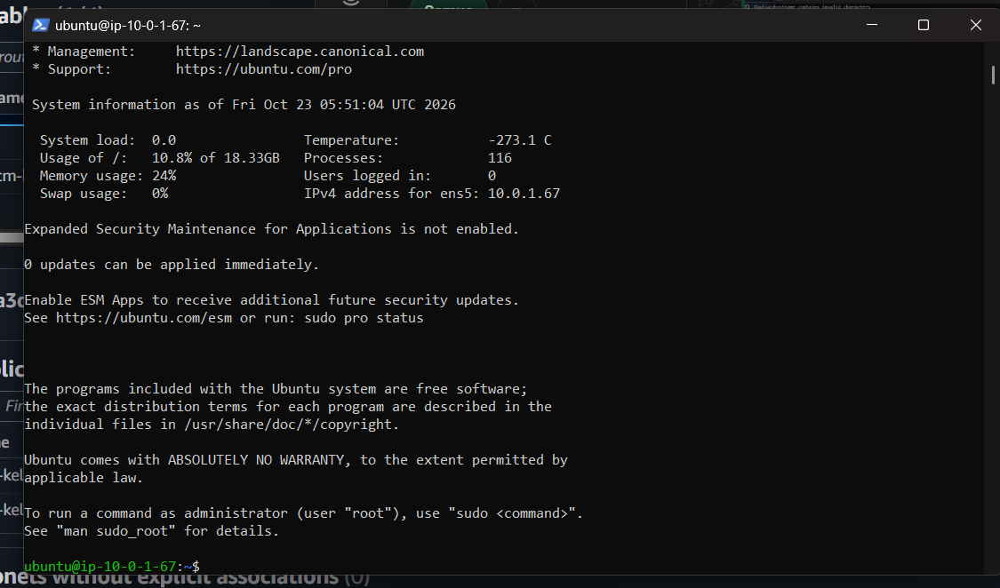 
  <em>Gambar 5.1: Berhasil masuk ke server lewat SSH, IP privat 10.0.1.67.</em>

## Langkah 6: Instal Software, Ambil Kode, dan Konfigurasi

Di dalam server dijalankan `apt update` dan `apt upgrade`, lalu dipasang `nginx`, `git`, dan `uv` sebagai pengelola paket Python. Kode di-clone dari repository tugas ke `/``srv``/``pcm``-website`, bukan ke folder home, karena Nginx (user `www-data`) tidak bisa membaca isi `/home/ubuntu`. Dependensi dipasang dengan `uv`` sync --frozen`, lalu file `.env` dibuat dari `deploy/env/level1.env.example`. `SECRET_KEY` dibuat acak dengan fungsi `get_random_secret_key` milik Django (nilainya tidak ditampilkan di laporan), sedangkan `ALLOWED_HOSTS` dan `CSRF_TRUSTED_ORIGINS` diisi dengan Elastic IP.

Setelah itu dijalankan `migrate`, `collectstatic` (129 file statis tersalin), `seed_pcm` untuk konten contoh, dan `createsuperuser` untuk akun admin (Gambar 6.1).

  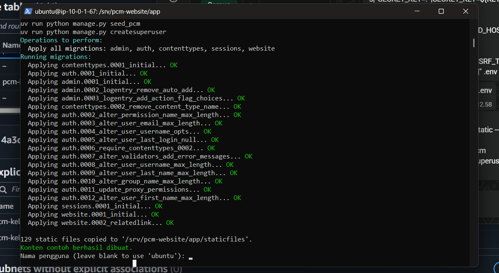 
  <em>Gambar 6.1: Hasil migrate, collectstatic, dan seed_pcm, lalu createsuperuser.</em>

## Langkah 7: Menjalankan Gunicorn sebagai Service systemd

File `deploy/``systemd``/``pcm.service` disalin ke `/etc/``systemd``/system/`, kemudian dijalankan `daemon-reload` dan `systemctl`` enable --now ``pcm`. Status service `active (running)` dan `enabled`, dengan Gunicorn 26.2.0 memakai 3 worker pada `127.0.0.1:8000`. Karena di-enable, service otomatis menyala saat server boot dan dinyalakan ulang oleh systemd jika crash. Uji `curl -I http://127.0.0.1:8000/` menghasilkan `HTTP/1.1 200 OK` (Gambar 7.1).

  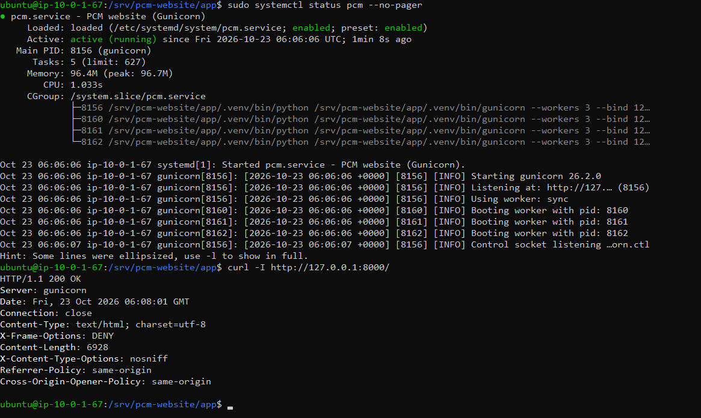 
  <em>Gambar 7.1: Status service pcm dan hasil curl ke Gunicorn, HTTP 200 OK.</em>

## Langkah 8: Memasang Nginx di Depan Gunicorn

File `deploy/nginx/``pcm.conf` disalin ke `/etc/nginx/sites-available/``pcm`, dibuat symlink ke `sites-enabled`, dan konfigurasi bawaan `default` dihapus. Setelah `nginx -t` menyatakan sintaks benar, Nginx di-reload. Pada konfigurasi ini `/static/` dan `/media/` disajikan langsung dari disk oleh Nginx, sedangkan request lainnya diteruskan (proxy) ke Gunicorn. Hasilnya website bisa dibuka lewat port 80 di `http://16.78.139.41/`. Service Nginx berstatus active (running) dan enabled, sehingga ikut menyala otomatis saat server boot (Gambar 8.1).

  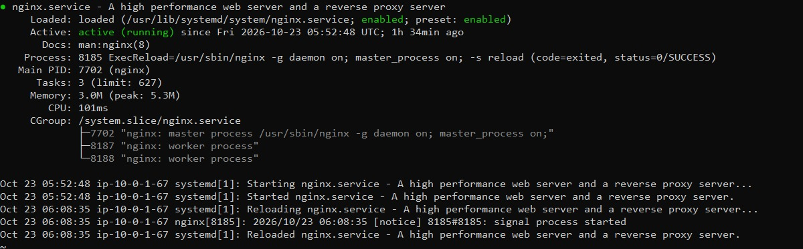 
  <em>Gambar 8.1: Status service Nginx, active (running) dan enabled.</em>

## Langkah 9: Verifikasi Website

Beranda website tampil dengan tema hijau dan CSS normal pada `http://16.78.139.41/` (Gambar 9.1). Halaman `/status/` menampilkan **Level 1 terdeteksi** dengan hostname `ip-10-0-1-67`, instance ID `i-07ec4ff3770bec377`, tipe `t``3.micro`, Availability Zone `ap-southeast-3a`, `DEBUG` bernilai False, storage media `FileSystemStorage`, S3 bucket tidak digunakan, serta database engine `sqlite` dengan file `db.sqlite3` di server (Gambar 9.2).

  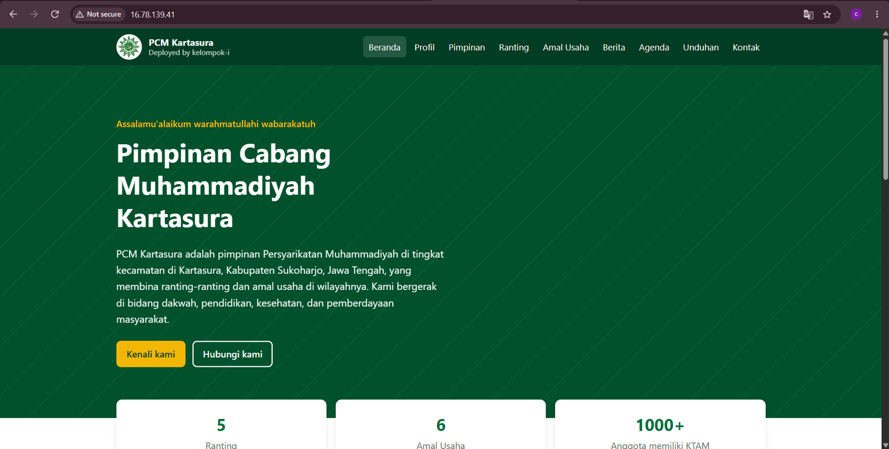 
  <em>Gambar 9.1: Beranda website PCM dengan tagline Deployed by kelompok-i di header.</em>

  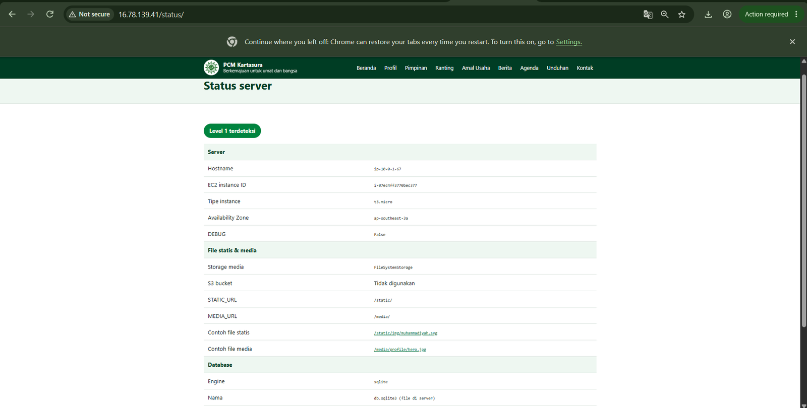 
  <em>Gambar 9.2: Halaman /status/ yang menunjukkan Level 1 terdeteksi.</em>

Lewat panel admin, tagline pada *Profil organisasi* diubah menjadi `Deployed by ``kelompok-i` dan satu berita dibuat dengan gambar unggahan sendiri. Keduanya tampil pada beranda, yaitu tagline di header dan berita pada bagian *Berita terbaru* (Gambar 9.3).

  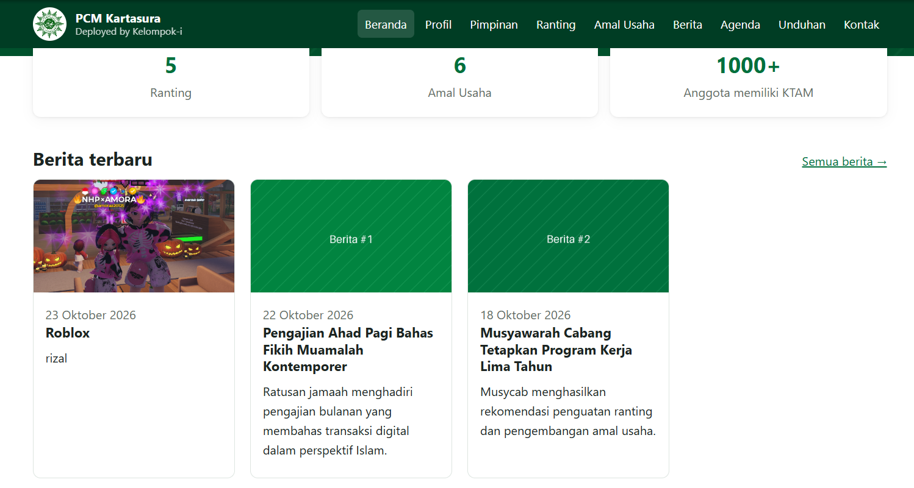 
  <em>Gambar 9.3: Tagline di header dan berita dengan gambar unggahan pada beranda.</em>

## Pertanyaan dan Jawaban

### 1. Perbedaan subnet publik dan subnet privat

**Pertanyaan:** Apa yang membuat `public-a` menjadi subnet publik dan `private-a` subnet privat?

Yang membedakan adalah route table yang terasosiasi. `public-a` memakai `pcm``-``kelompok``-``i``-public-rt` yang memiliki route `0.0.0.0/0` menuju Internet Gateway, jadi resource di dalamnya bisa menerima dan mengirim lalu lintas ke internet selama punya IP publik (pada tugas ini Elastic IP). `private-a` memakai `pcm``-``kelompok``-``i``-private-rt` yang hanya berisi route `local` untuk 10.0.0.0/16, sehingga tidak ada jalur ke internet. Kata public dan private pada nama subnet hanyalah label yang kami buat sendiri.

### 2. Pembatasan SSH hanya dari IP anggota

**Pertanyaan:** Mengapa security group web hanya mengizinkan SSH dari IP anggota kelompok? Apa yang bisa terjadi jika diizinkan dari `0.0.0.0/0`?

Port 22 adalah pintu masuk ke terminal server. Jika dibatasi ke IP anggota dengan `/32`, hanya komputer kami yang bisa mencoba login sehingga permukaan serangan jauh lebih kecil. Jika dibuka ke `0.0.0.0/0`, siapa pun di internet bisa mencoba login. Bot akan terus melakukan scan dan brute force password atau key. Kalau ada yang berhasil masuk, penyerang bisa membaca file `.env` berisi `SECRET_KEY`, mengambil database, memasang malware, atau memakai server untuk hal lain yang membuat tagihan membengkak. Kekurangannya, rule harus diperbarui kalau IP anggota berubah, misalnya saat berpindah jaringan.

### 3. Peran Nginx dan Gunicorn

**Pertanyaan:** Apa yang dikerjakan Nginx yang tidak dikerjakan Gunicorn sendirian? Mengapa Gunicorn mendengarkan di `127.0.0.1`, bukan `0.0.0.0`?

Gunicorn adalah application server yang menjalankan kode Django lewat WSGI. Ia tidak dirancang untuk berhadapan langsung dengan internet dan kurang efisien untuk menyajikan file statis. Nginx mengambil peran itu: menerima koneksi dari pengunjung (termasuk koneksi yang lambat), menyajikan `/static/` dan `/media/` langsung dari disk, lalu meneruskan request dinamis ke Gunicorn. Nginx juga yang nantinya bisa dipasangi HTTPS. Gunicorn dibuat mendengarkan di `127.0.0.1` supaya hanya proses di server yang sama, yaitu Nginx, yang bisa mengaksesnya. Jika memakai `0.0.0.0`, Gunicorn terikat ke semua interface sehingga bisa diakses langsung dari luar tanpa lewat Nginx kalau security group salah diatur.

### 4. Dampak instance EC2 di-terminate

**Pertanyaan:** Pada konfigurasi ini, apa yang terjadi pada gambar unggahan dan database jika instance EC2 di-*terminate*?

Keduanya hilang. Database SQLite (`db.sqlite3`) dan folder `media/` tersimpan di disk instance, dan secara bawaan volume root ikut dihapus saat instance di-terminate. Dampaknya berita, pesan masuk dari formulir kontak, gambar unggahan, dan akun admin ikut lenyap. Yang tersisa hanya kode di GitHub. Inilah alasan adanya Level 2, yaitu memindahkan file statis dan media ke S3, dan Level 3, yaitu memindahkan database ke PostgreSQL di RDS.

## Kesimpulan

Website PCM berhasil berjalan di satu instance EC2 pada VPC buatan sendiri dan dapat diakses publik lewat Elastic IP 16.78.139.41. Jaringan dirancang dengan dua subnet publik dan dua subnet privat di dua Availability Zone, security group hanya membuka HTTP untuk publik dan SSH untuk IP anggota, serta Gunicorn dijalankan sebagai service systemd di belakang Nginx. Kekurangan konfigurasi Level 1 adalah database dan file media masih berada di disk instance yang sama sehingga belum andal, dan hal ini diperbaiki pada Level 2 dan Level 3.

---

[← README](../README.md) · [README](../README.md) · [Galeri bukti](../evidence/README.md) · [Level 2 →](level-2-s3-iam.md)
