# Level 2: S3 dan IAM Role

[← Level 1](level-1-vpc-ec2.md) · [README](../README.md) · [Galeri bukti](../evidence/README.md) · [Level 3 →](level-3-rds.md)

> File statis dan media dipindah ke Amazon S3. EC2 menulis ke bucket lewat IAM role tanpa access key. Halaman ini adalah salinan markdown dari [laporan PDF](Laporan_Tugas1_Level1-3_Kelompok_I.pdf), dengan screenshot yang datanya sudah disamarkan.

---

Pada Level 2, file statis (CSS, JavaScript, gambar) dan file media unggahan admin dipindah dari disk EC2 ke bucket Amazon S3 `pcm-kelompok-i-assets`. Instance EC2 mendapat izin menulis ke bucket lewat IAM role, sehingga tidak ada access key di server maupun di file mana pun. Django tetap membuat halaman HTML, tetapi setiap alamat CSS dan gambar kini mengarah ke S3 dan browser mengunduhnya langsung dari sana. Database masih berupa SQLite di disk instance dan baru dipindah pada Level 3.

## Tabel Kontribusi Anggota (Level 2)

Pembagian pekerjaan setiap anggota pada Level 2 adalah sebagai berikut.

| **No** | **Nama**                         | **Kontribusi**                                                                                                                              |
|--------|----------------------------------|---------------------------------------------------------------------------------------------------------------------------------------------|
| 1      | Raden Bagus Indra Wijaya Nugraha | Menguji unggahan gambar lewat admin ke S3, akses URL file (AccessDenied dan file satuan),dan memverifikasi halaman /status/ dan page source |
| 2      | Raka Aleksano Prugesta           | Membuat diagram arsitektur Level 2 dan menyusun laporan                                                                                     |
| 3      | Fathkul Choiri                   | Mengalihkan Django ke S3 lewat .env, memverifikasi halaman /status/ dan page source                                                         |
| 4      | Muhammad Afif Haravi             | Memasang IAM role pada EC2, memasang AWS CLI dan memeriksa role, menjalankan sync media dan collectstatic                                   |
| 5      | Muhammad Nurrizal Ramadhani      | Membuat bucket S3, bucket policy, serta IAM role beserta inline policy                                                                      |

## Diagram Arsitektur Level 2

Gambar 2 menunjukkan arsitektur setelah Level 2. Bagian VPC, subnet, dan EC2 tidak berubah dari Level 1. Yang bertambah adalah bucket S3 dan IAM role yang terpasang pada instance. Saat unggahan dan `collectstatic`, Django memakai kredensial sementara dari IAM role untuk menulis ke bucket.

  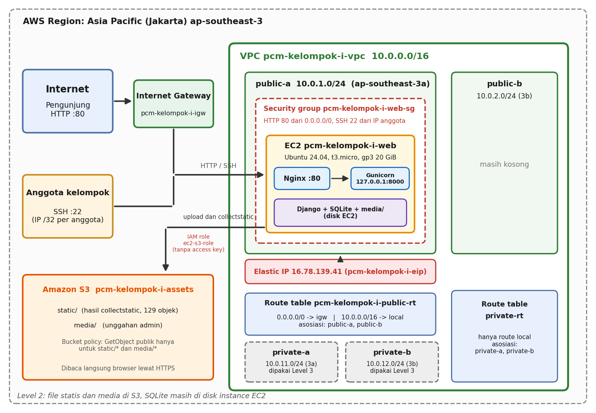 
  <em>Gambar 2: Diagram arsitektur Level 2 (ditambah S3 dan IAM role).</em>

## Langkah 1: Membuat Bucket S3

Bucket dibuat di region yang sama dengan EC2, yaitu Asia Pacific (Jakarta), dengan nama `pcm-kelompok-i-assets`. Object Ownership diatur ke *ACLs disabled (Bucket owner enforced)* sehingga akses dikendalikan hanya lewat bucket policy (Gambar L2.1.2). Pengaturan *Block all public access* dimatikan karena website perlu membaca file statis dan media secara publik. Pembacaan publik itu tidak dibuka untuk seluruh bucket, melainkan dibatasi lewat bucket policy pada Langkah 2 (Gambar L2.1.1). Di dalam bucket terdapat dua folder, yaitu `static/` untuk hasil `collectstatic` dan `media/` untuk unggahan admin (Gambar L2.1.3).

  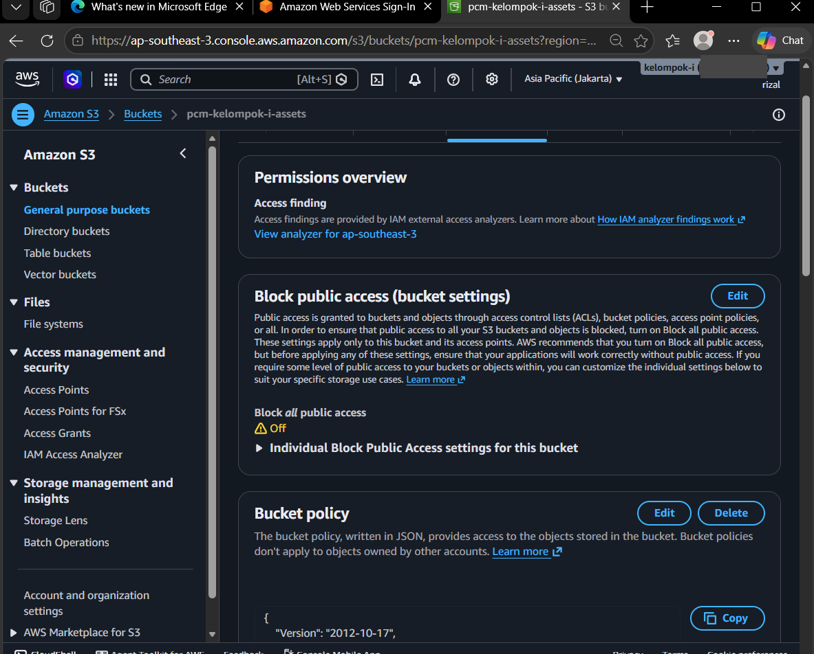 
  <em>Gambar L2.1.1: Tab Permissions bucket, Block all public access dimatikan.</em>

  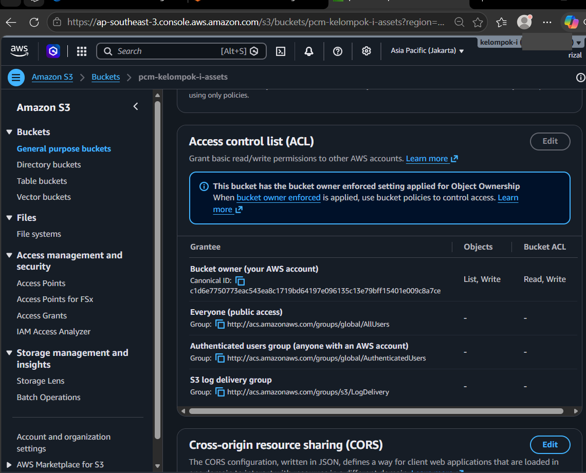 
  <em>Gambar L2.1.2: Object Ownership bucket owner enforced, ACL tidak dipakai.</em>

  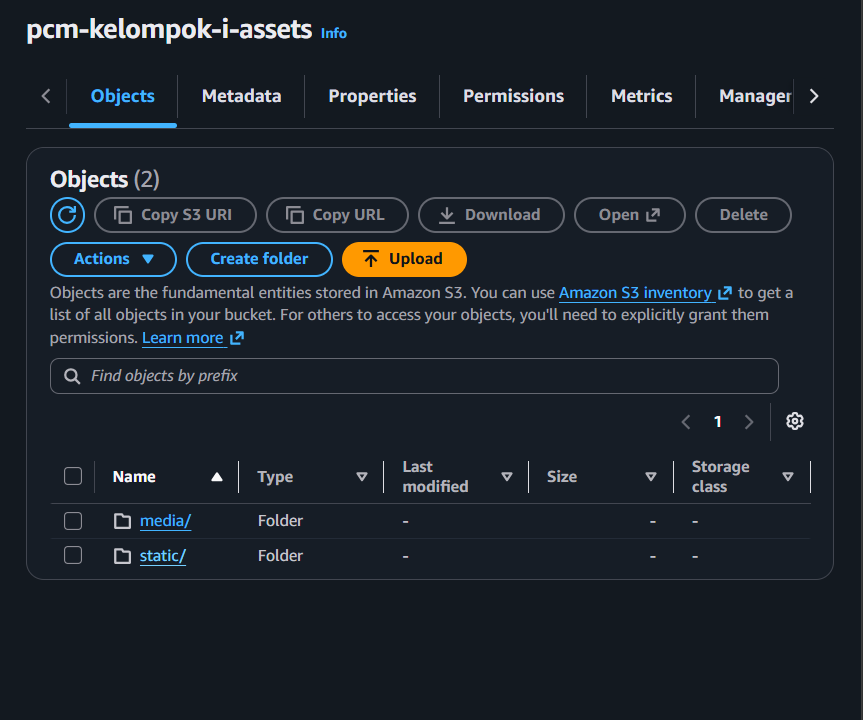 
  <em>Gambar L2.1.3: Isi bucket, folder media/ dan static/.</em>

## Langkah 2: Bucket Policy

Bucket policy hanya memberi izin `s``3:GetObject` kepada siapa pun (`Principal: *`) untuk objek di `static/*` dan `media/*` (Gambar L2.2.1). Karena yang diizinkan hanya membaca objek, pengunjung bisa membuka file satuan lewat URL-nya, tetapi tidak bisa melihat daftar isi bucket dan tidak bisa menulis atau menghapus apa pun.

  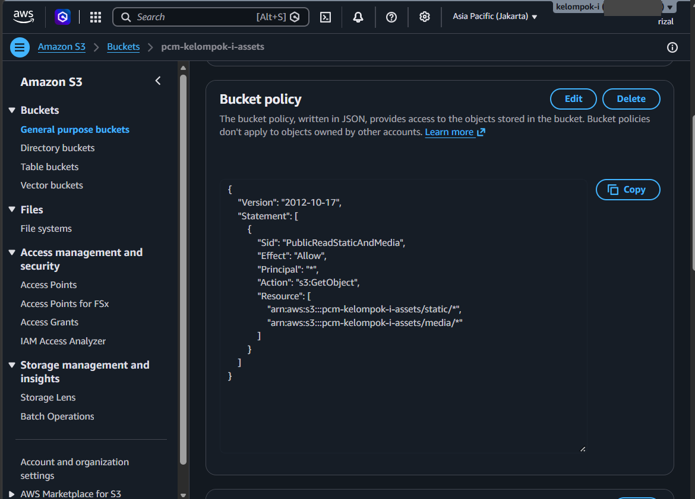 
  <em>Gambar L2.2.1: Bucket policy, GetObject hanya untuk static/\* dan media/\*.</em>

## Langkah 3: IAM Role untuk Instance EC2

Dibuat IAM role `pcm-kelompok-i-ec2-s3-role` dengan trusted entity layanan EC2. Trust relationship-nya mengizinkan `ec2.amazonaws.com` melakukan `sts:AssumeRole`, artinya hanya instance EC2 yang bisa memakai role ini (Gambar L2.3.1). Izin akses ke bucket diberikan lewat inline policy `pcm-s3-access` (Gambar L2.3.2) yang terdiri dari dua statement:

**1. ListBucket.** Mengizinkan `s``3:ListBucket` pada ARN bucket `arn:aws``:s``3:::``pcm-kelompok-i-assets`. Izin ini dibutuhkan agar `collectstatic` dan `aws s3 sync` bisa memeriksa objek yang sudah ada di bucket.

**2. ManageObjects.** Mengizinkan `s``3:GetObject`, `s``3:PutObject`, dan `s``3:DeleteObject` pada `arn:aws``:s``3:::``pcm-kelompok-i-assets/*`. Izin ini dipakai untuk membaca, mengunggah, dan mengganti atau menghapus file statis dan media.

Role sengaja tidak diberi izin lebih dari itu sesuai prinsip *least privilege*. Tidak ada `s``3:*`, tidak ada akses ke bucket lain, dan tidak ada izin mengubah bucket policy atau menghapus bucket. Kalau server sampai disusupi, kerusakan yang mungkin terjadi hanya terbatas pada isi bucket ini. Terakhir, role dipasang pada instance lewat *Actions, Security, Modify IAM role* (Gambar L2.3.3).

  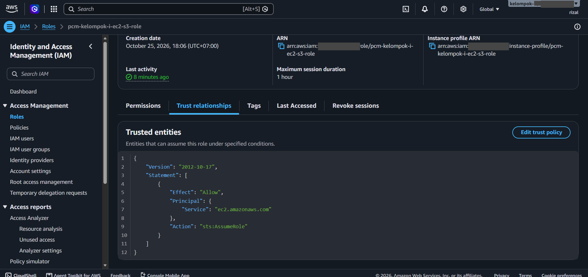 
  <em>Gambar L2.3.1: Trust relationship role, hanya ec2.amazonaws.com yang boleh assume role.</em>

  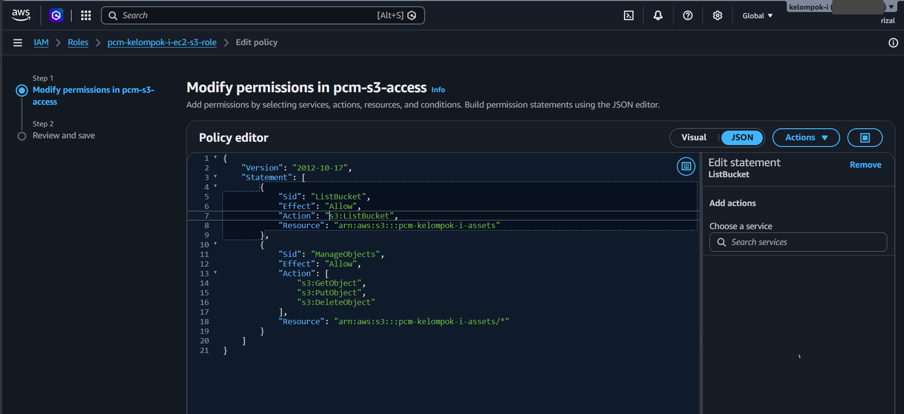 
  <em>Gambar L2.3.2: Inline policy pcm-s3-access (ListBucket dan ManageObjects).</em>

  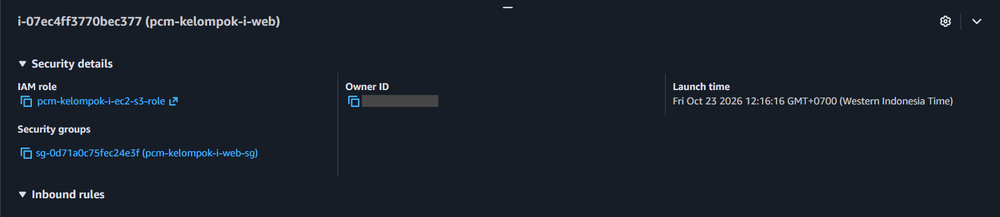 
  <em>Gambar L2.3.3: Detail instance, IAM role pcm-kelompok-i-ec2-s3-role terpasang.</em>

## Langkah 4: Memeriksa Role dari Dalam Instance

AWS CLI dipasang dengan `snap install aws-cli --classic`, lalu region diatur ke `ap-southeast-3` lewat variabel `AWS_DEFAULT_REGION` karena Jakarta adalah region opt-in. Perintah `aws sts get-caller-identity` menghasilkan ARN `assumed-role/pcm-kelompok-i-ec2-s3-role/i-07ec4ff3770bec377` (Gambar L2.4.1). Ini membuktikan instance memakai kredensial sementara dari IAM role. Tidak ada perintah `aws configure` dan tidak ada key yang disimpan.

  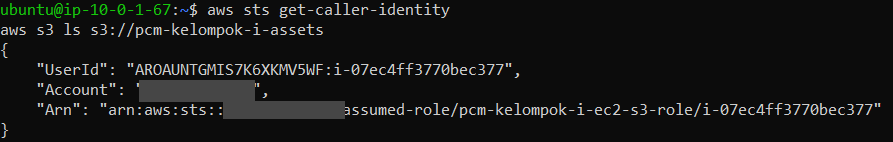 
  <em>Gambar L2.4.1: Hasil aws sts get-caller-identity, identitasnya assumed-role.</em>

## Langkah 5: Memindahkan File Media dari Level 1

Gambar yang dibuat pada Level 1 masih ada di `/srv/pcm-website/app/media/`. Folder itu disalin ke bucket dengan `aws s3 sync media/ s3://pcm-kelompok-i-assets/media/`. Hasilnya terlihat pada daftar objek di `media/` (satu tangkapan layar yang sama juga memuat `collectstatic` dari Langkah 6), yaitu dokumen, gambar lembaga, gambar pimpinan, gambar berita, dan `hero.jpg` (Gambar L2.5.1). Struktur foldernya sama persis dengan di disk.

  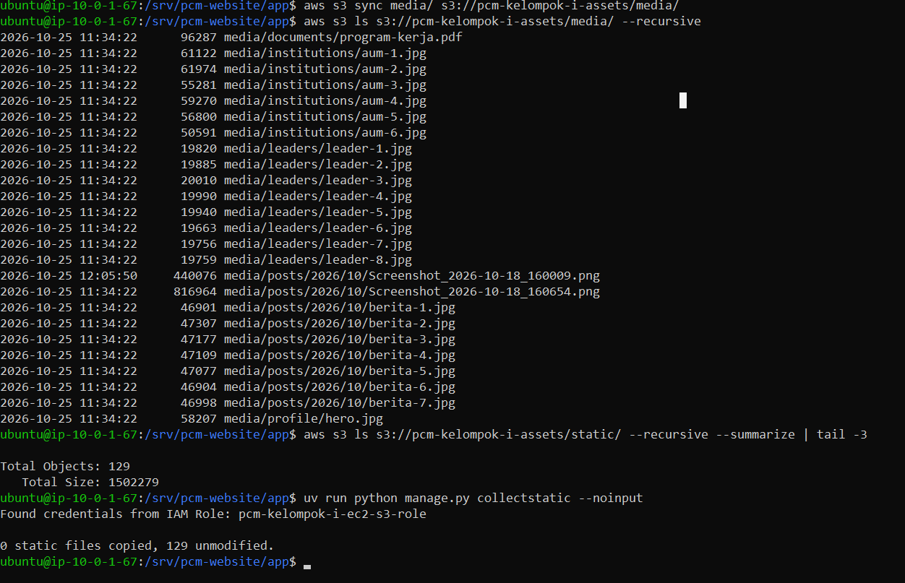 
  <em>Gambar L2.5.1: Hasil sync media, daftar objek di S3, dan collectstatic.</em>

## Langkah 6: Mengalihkan Django ke S3

File `.env` dicadangkan lebih dulu ke `.``env.level1.bak`. `SECRET_KEY`, `ALLOWED_HOSTS`, dan `CSRF_TRUSTED_ORIGINS` dipertahankan, lalu ditambahkan `USE_S3=true`, `AWS_STORAGE_BUCKET_NAME=pcm-kelompok-i-assets`, dan `AWS_S3_REGION_NAME=ap-southeast-3`. Tidak ada kode Python yang diubah karena `settings.py` membaca `USE_S3` dan mengganti storage backend. Setelah itu dijalankan `collectstatic` untuk mengunggah file statis ke S3 dan service di-restart.

Pada keluaran `collectstatic` muncul pesan *Found credentials from IAM Role: pcm-kelompok-i-ec2-s3-role*, yang menegaskan bahwa kredensial berasal dari role. Bucket berisi 129 objek statis dengan total sekitar 1,5 MB, dan `collectstatic` melaporkan 0 file disalin serta 129 tidak berubah karena semua file sudah terunggah (Gambar L2.5.1).

Isi `.env` yang relevan ditampilkan dengan `grep` supaya `SECRET_KEY` tidak ikut tampil (Gambar L2.6.1). Variabel `USE_S3=true`, nama bucket, dan region sudah terisi. Perintah `grep -c` untuk `AWS_ACCESS_KEY` dan `AWS_SECRET_ACCESS_KEY` menghasilkan 0, sehingga tidak ada access key di `.env`.

  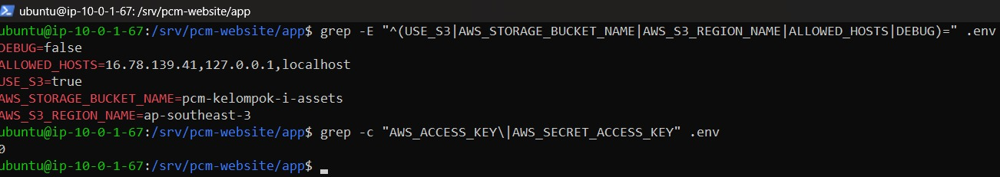 
  <em>Gambar L2.6.1: Konfigurasi S3 pada .env dan bukti tidak ada access key.</em>

## Langkah 7: Verifikasi

**a. Halaman status.** `/status/` menampilkan **Level 2 terdeteksi** dengan Storage media `S3Storage`, S3 bucket `pcm-kelompok-i-assets`, serta `STATIC_URL` dan `MEDIA_URL` yang mengarah ke `https://pcm-kelompok-i-assets.s3.ap-southeast-3.amazonaws.com/static/` dan `.../media/` (Gambar L2.7.1).

  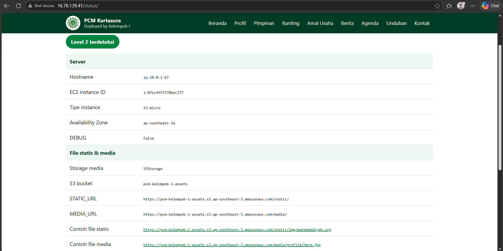 
  <em>Gambar L2.7.1: Halaman /status/ yang menunjukkan Level 2 terdeteksi dan S3Storage.</em>

**b. Page source.** Pada page source beranda (`view-source:16.78.139.41`), stylesheet `style.css`, ikon, dan logo dimuat dari URL bucket S3, bukan dari `/static/` di server (Gambar L2.7.2).

  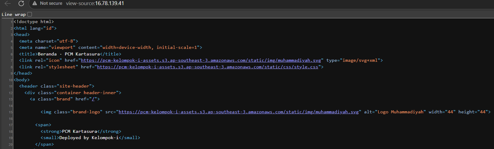 
  <em>Gambar L2.7.2: Page source beranda, CSS dan logo dimuat dari S3.</em>

**c. Unggahan baru masuk ke S3.** Satu gambar baru, `uji-s3.png`, diunggah lewat admin. Perintah `find` pada folder `media/` di server tidak menemukan file itu, sedangkan `aws s3 ls` menampilkannya di `media/posts/2026/10/uji-s3.png` (Gambar L2.7.3). File yang sama terlihat pada konsol S3 (Gambar L2.7.4). Jadi unggahan tidak lagi tersimpan di disk EC2.

  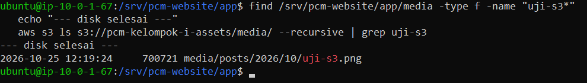 
  <em>Gambar L2.7.3: find tidak menemukan file di disk EC2, tetapi file ada di S3.</em>

  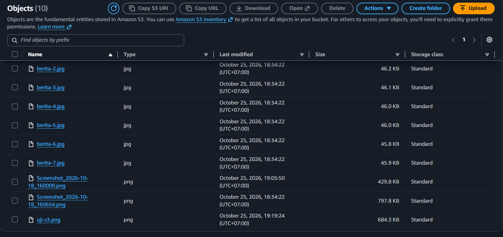 
  <em>Gambar L2.7.4: Objek uji-s3.png pada media/posts/2026/10/ di konsol S3.</em>

**d. File satuan bisa dibuka, isi bucket tidak.** File di `static/` dan `media/` dapat dibuka langsung lewat URL-nya, misalnya `static/css/style.css` (Gambar L2.7.5) dan `media/profile/hero.jpg` (Gambar L2.7.6). Sebaliknya, mengakses URL bucket menghasilkan galat `AccessDenied` (Gambar L2.7.7), sehingga daftar isi bucket tidak bisa dilihat publik.

  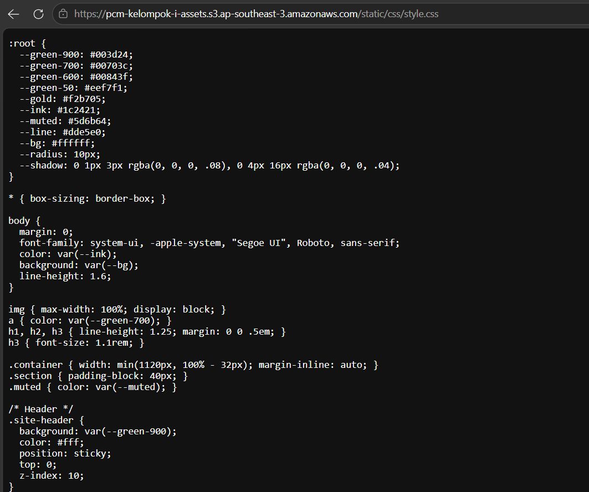 
  <em>Gambar L2.7.5: static/css/style.css terbuka langsung dari S3.</em>

  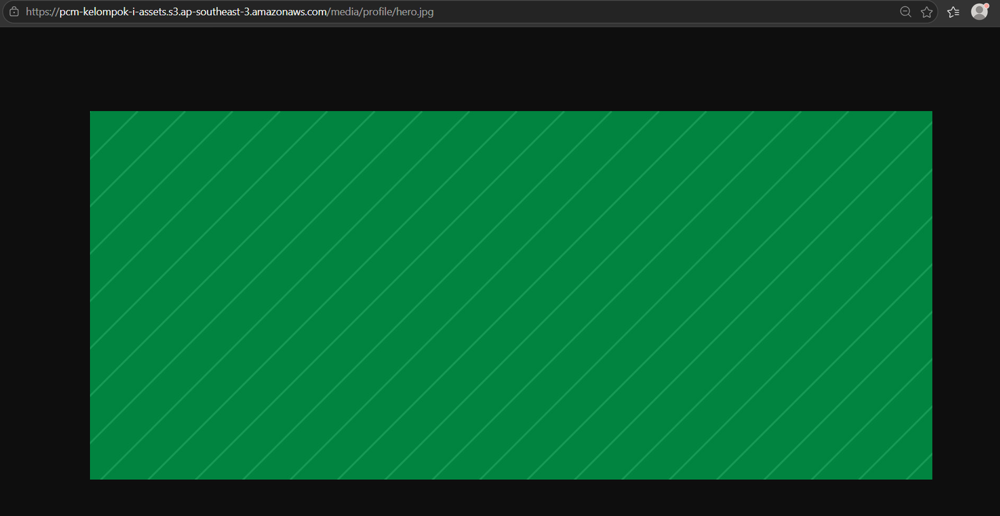 
  <em>Gambar L2.7.6: media/profile/hero.jpg terbuka langsung dari S3.</em>

  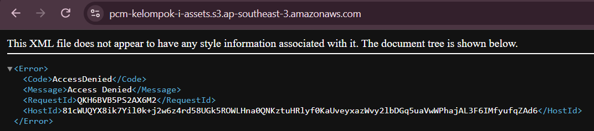 
  <em>Gambar L2.7.7: Mengakses bucket menghasilkan AccessDenied.</em>

## Pertanyaan dan Jawaban

### 1. IAM role dibanding access key

**Pertanyaan:** Mengapa IAM role lebih aman daripada menaruh `AWS_ACCESS_KEY_ID` dan `AWS_SECRET_ACCESS_KEY` di `.env`?

Access key berlaku lama dan bisa dipakai dari mana saja. Kalau tersimpan di `.env`, key itu bisa bocor lewat repository, screenshot, backup, atau server yang diretas, dan penyerang bisa memakainya dari komputernya sendiri sampai key dicabut. Key juga harus diganti secara manual. IAM role bekerja berbeda. Instance mengambil kredensial sementara dari instance metadata service, kredensial itu berganti otomatis, dan tidak ada rahasia yang tertulis di file mana pun. Kalau `.env` bocor, isinya tidak bisa dipakai untuk mengakses bucket. Aturan tugas juga memberi pengurangan nilai bagi access key yang ditemukan di server.

### 2. Cakupan bucket policy

**Pertanyaan:** Bucket policy hanya mengizinkan `s``3:GetObject` untuk `static/*` dan `media/*`. Apa yang berubah jika diizinkan untuk `arn:aws``:s``3:::``pcm-kelompok-i-assets/*`? Bagaimana jika `s``3:*`?

Jika resource diganti menjadi `pcm-kelompok-i-assets/*`, semua objek di seluruh bucket bisa dibaca publik, termasuk file yang kelak diletakkan di folder lain, misalnya backup atau berkas internal. Kontrol per folder hilang. Jika actionnya diganti menjadi `s``3:*` untuk semua orang, risikonya jauh lebih besar. Siapa pun di internet bisa mengunggah, menimpa, menghapus objek, bahkan mengubah policy bucket. Akibatnya data bisa hilang, bucket dipakai untuk menyebarkan malware, dan tagihan bisa membengkak.

### 3. Keuntungan menyajikan file dari S3

**Pertanyaan:** Sebutkan dua keuntungan menyajikan file dari S3 dibanding dari disk EC2, dengan membayangkan dua atau lebih instance EC2 di belakang load balancer.

Pertama, file menjadi **terpusat dan konsisten**. Dengan disk lokal, gambar yang diunggah lewat instance A tidak ada di instance B, sehingga gambar kadang tampil dan kadang 404 tergantung instance yang melayani. Dengan S3, semua instance membaca dan menulis ke satu tempat yang sama. Kedua, beban dan **ketahanan** lebih baik. Pengunjung mengunduh file langsung dari S3 yang skalanya besar dan datanya disimpan dengan durabilitas tinggi, sehingga instance EC2 hanya fokus membuat halaman HTML dan bisa ditambah, diganti, atau dihapus tanpa menyalin file.

### 4. Yang masih di disk EC2

**Pertanyaan:** Bagian aplikasi apa yang masih tersimpan hanya di disk EC2 setelah Level 2?

Yang paling penting adalah **database SQLite** (`db.sqlite3`) yang berisi berita, pesan kontak, dan akun admin. Selain itu masih ada di disk kode aplikasi hasil clone, virtual environment, file `.env`, konfigurasi Nginx dan systemd, serta log. Jika instance di-terminate, database ikut hilang. Inilah alasan adanya Level 3, yaitu memindahkan database ke PostgreSQL di RDS.

## Kesimpulan Level 2

File statis dan media kini disimpan dan disajikan dari bucket S3 `pcm-kelompok-i-assets`, dengan akses tulis dari instance lewat IAM role `pcm-kelompok-i-ec2-s3-role` tanpa satu pun access key. Bucket policy hanya membuka pembacaan untuk `static/*` dan `media/*`, dan pengujian menunjukkan isi bucket tidak bisa dilihat publik. Website tetap berjalan normal dan unggahan baru langsung masuk ke S3. Yang masih bergantung pada disk instance adalah database SQLite, dan itu diselesaikan pada Level 3.

---

[← Level 1](level-1-vpc-ec2.md) · [README](../README.md) · [Galeri bukti](../evidence/README.md) · [Level 3 →](level-3-rds.md)
