# Level 3: RDS PostgreSQL

[← Level 2](level-2-s3-iam.md) · [README](../README.md) · [Galeri bukti](../evidence/README.md) · [Selesai: kembali ke README →](../README.md)

> Database dipindah ke Amazon RDS for PostgreSQL di subnet privat. EC2 tidak lagi menyimpan state. Halaman ini adalah salinan markdown dari [laporan PDF](Laporan_Tugas1_Level1-3_Kelompok_I.pdf), dengan screenshot yang datanya sudah disamarkan.

---

Pada Level 3, database website dipindah dari file SQLite di disk EC2 ke Amazon RDS for PostgreSQL dengan nama `pcm-kelompok-i-db`. Instance RDS diletakkan di subnet privat sehingga tidak bisa diakses dari internet, hanya dari security group web server. Semua data dari Level 1 ikut dimigrasi, yaitu akun admin, konten website, dan pesan kontak. Setelah level ini instance EC2 tidak lagi menyimpan state apa pun karena file statis dan media ada di S3 dan data ada di RDS. Semua resource tetap berada di region Asia Pacific (Jakarta) `ap-southeast-3` dan memakai VPC, instance EC2, serta bucket S3 yang sama dengan Level 1 dan Level 2.

## Tabel Kontribusi Anggota (Level 3)

Pembagian pekerjaan setiap anggota pada Level 3 adalah sebagai berikut.

| **No** | **Nama**                         | **Kontribusi**                                                                                                                |
|--------|----------------------------------|-------------------------------------------------------------------------------------------------------------------------------|
| 1      | Raden Bagus Indra Wijaya Nugraha | Membuat security group database, DB subnet group, dan instance RDS, serta menguji koneksi `psql` dari EC2                     |
| 2      | Raka Aleksano Prugesta           | Membuat diagram arsitektur Level 3 dan menyusun laporan                                                                       |
| 3      | Fathkul Choiri                   | Memeriksa tabel dan isi data di RDS lewat `psql`, serta menyusun laporan                                                      |
| 4      | Muhammad Afif Haravi             | Mengekspor data SQLite dengan `dumpdata`, mengalihkan Django ke PostgreSQL lewat `.env`, menjalankan `migrate` dan `loaddata` |
| 5      | Muhammad Nurrizal Ramadhani      | Memverifikasi halaman `/status/` dan data di admin, serta menguji akses database dari laptop                                  |

## Diagram Arsitektur Level 3

Gambar 3 menunjukkan arsitektur setelah Level 3. VPC, subnet publik, instance EC2, bucket S3, dan IAM role tidak berubah dari level sebelumnya. Yang bertambah adalah security group `pcm-kelompok-i-db-sg`, DB subnet group yang berisi `private-a` dan `private-b`, serta instance RDS yang berada di `private-b` (Availability Zone 3b). Instance EC2 di `public-a` terhubung ke RDS lewat port 5432 dengan `sslmode=require`. Subnet `private-a` tidak berisi instance, tetapi tetap harus ada di dalam subnet group karena RDS mensyaratkan subnet pada minimal dua Availability Zone. Laptop yang berada di luar VPC tidak punya jalur ke database.

  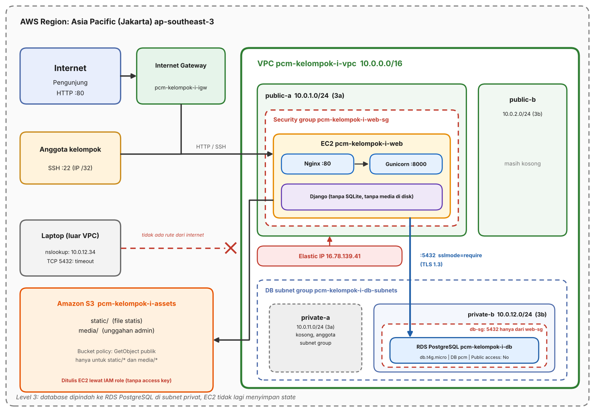 
  <em>Gambar 3: Diagram arsitektur Level 3 (ditambah RDS PostgreSQL di subnet privat).</em>

## Langkah 1: Security Group Database

Security group `pcm-kelompok-i-db-sg` (`sg-04b644ca0189eb388`) dibuat di dalam `pcm-kelompok-i-vpc` dengan deskripsi *Allow PostgreSQL from web server*. Security group ini hanya punya satu inbound rule, yaitu PostgreSQL TCP port 5432 (Gambar L3.1.1). Sumber rule tersebut adalah security group `pcm-kelompok-i-web-sg`, bukan rentang alamat IP, sehingga yang boleh mengakses database hanyalah resource yang memakai `web-sg`. Alasan pemilihan ini dijelaskan pada jawaban pertanyaan nomor 2.

  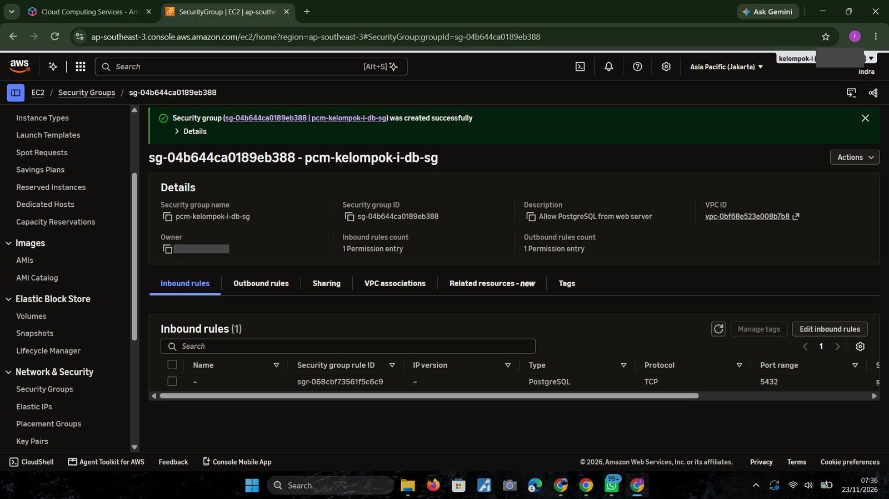 
  <em>Gambar L3.1.1: Security group pcm-kelompok-i-db-sg dengan satu inbound rule PostgreSQL port 5432.</em>

## Langkah 2: DB Subnet Group

DB subnet group `pcm-kelompok-i-db-subnets` dibuat di `pcm-kelompok-i-vpc` dengan deskripsi *Private subnets for RDS*. Isinya hanya dua subnet privat pada dua Availability Zone seperti pada tabel berikut, tanpa satu pun subnet publik (Gambar L3.2.1).

| **Nama subnet**          | **Availability Zone** | **CIDR**     | **Subnet ID**            |
|--------------------------|-----------------------|--------------|--------------------------|
| pcm-kelompok-i-private-a | ap-southeast-3a       | 10.0.11.0/24 | subnet-0b4031887d06870aa |
| pcm-kelompok-i-private-b | ap-southeast-3b       | 10.0.12.0/24 | subnet-0b7628a54c63a7ddb |

  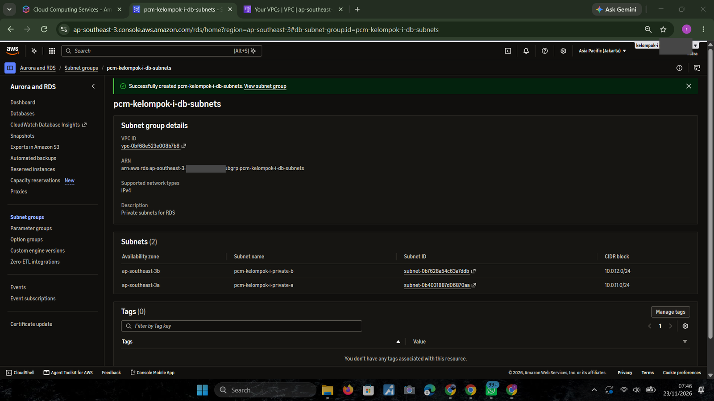 
  <em>Gambar L3.2.1: DB subnet group pcm-kelompok-i-db-subnets berisi private-a dan private-b.</em>

## Langkah 3: Membuat Instance RDS

Instance dibuat lewat *Standard create* dengan konfigurasi berikut. Password master dibuat hanya dari huruf dan angka supaya tidak perlu di-*escape* pada `DATABASE_URL`, dan nilainya tidak ditampilkan di laporan ini.

| **Parameter**          | **Nilai**                                                         |
|------------------------|-------------------------------------------------------------------|
| DB instance identifier | `pcm-kelompok-i-db`                                               |
| Engine                 | PostgreSQL (server versi 18.3, terlihat pada keluaran `psql`)     |
| Instance class         | `db.t4g.micro`                                                    |
| Master username        | `pcm_admin` (credentials *self managed*)                          |
| Initial database name  | `pcm`                                                             |
| Port                   | 5432                                                              |
| VPC                    | `pcm-kelompok-i-vpc`                                              |
| DB subnet group        | `pcm-kelompok-i-db-subnets`                                       |
| Publicly accessible    | No                                                                |
| VPC security group     | `pcm-kelompok-i-db-sg` (menggantikan `default`)                   |
| Availability Zone      | `ap-southeast-3b`                                                 |
| Endpoint               | `pcm-kelompok-i-db.c5swo8g8y73k.ap-southeast-3.rds.amazonaws.com` |

Setelah proses pembuatan selesai, status instance berubah menjadi *Available* (Gambar L3.3.1). Pada tab *Connectivity & security* terlihat nama database `pcm`, master username `pcm_admin`, port 5432, dan *Internet access gateway* berstatus *Disabled* (Gambar L3.3.2). Detail jaringannya menunjukkan instance berada di `pcm-kelompok-i-vpc` memakai subnet group `pcm-kelompok-i-db-subnets`, security group `pcm-kelompok-i-db-sg` berstatus *Active*, dan **Publicly accessible: No** (Gambar L3.3.3).

  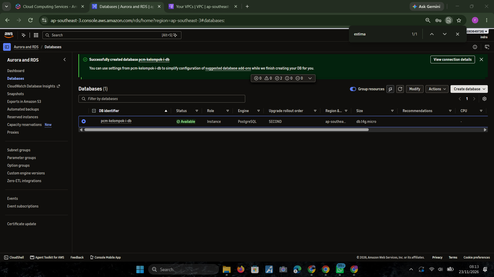 
  <em>Gambar L3.3.1: Instance pcm-kelompok-i-db berstatus Available.</em>

  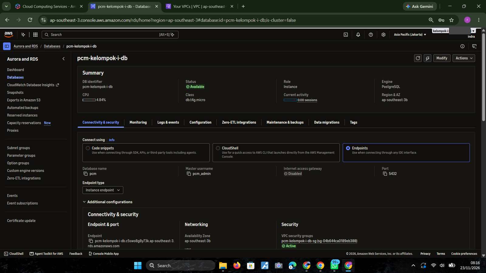 
  <em>Gambar L3.3.2: Tab Connectivity & security, endpoint, database pcm, dan Internet access gateway Disabled.</em>

  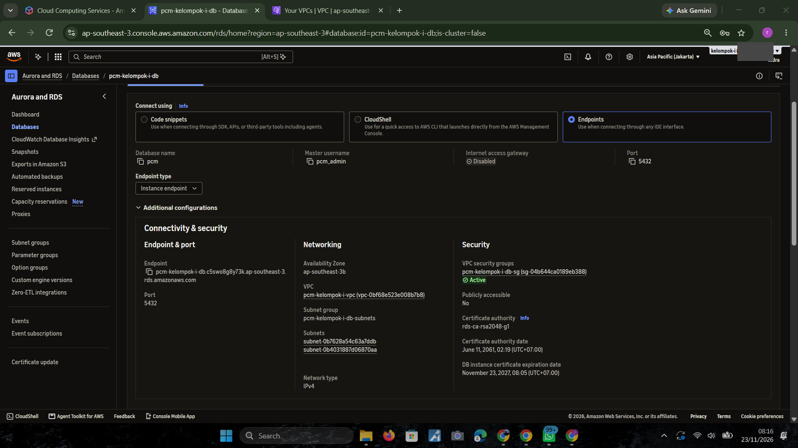 
  <em>Gambar L3.3.3: Detail jaringan RDS, VPC, subnet group, security group, dan Publicly accessible No.</em>

## Langkah 4: Menguji Koneksi dari EC2

Sebelum menyentuh Django, jalur jaringan dari EC2 ke RDS diuji lebih dulu. Paket `postgresql-client` dipasang, lalu koneksi dibuka dengan `psql "host=<ENDPOINT> port=5432 dbname=pcm user=pcm_admin sslmode=require"`. Password diminta lewat prompt sehingga tidak tertulis di perintah. Koneksi berhasil dengan keterangan *SSL connection (protocol: TLSv1.3, cipher: TLS_AES_256_GCM_SHA384)* dan prompt berubah menjadi `pcm=>` (Gambar L3.4.1).

Perintah `\dt` mengembalikan *Did not find any relations*. Ini wajar karena database `pcm` baru dibuat dan belum ada tabel sama sekali. Ada juga peringatan bahwa versi mayor `psql` (16) berbeda dari server (18). Peringatan itu hanya berarti beberapa fitur `psql` mungkin tidak berjalan sempurna dan tidak mengganggu pengujian ini. Hasilnya membuktikan security group dan routing sudah benar, sehingga langkah berikutnya bisa dilanjutkan.

  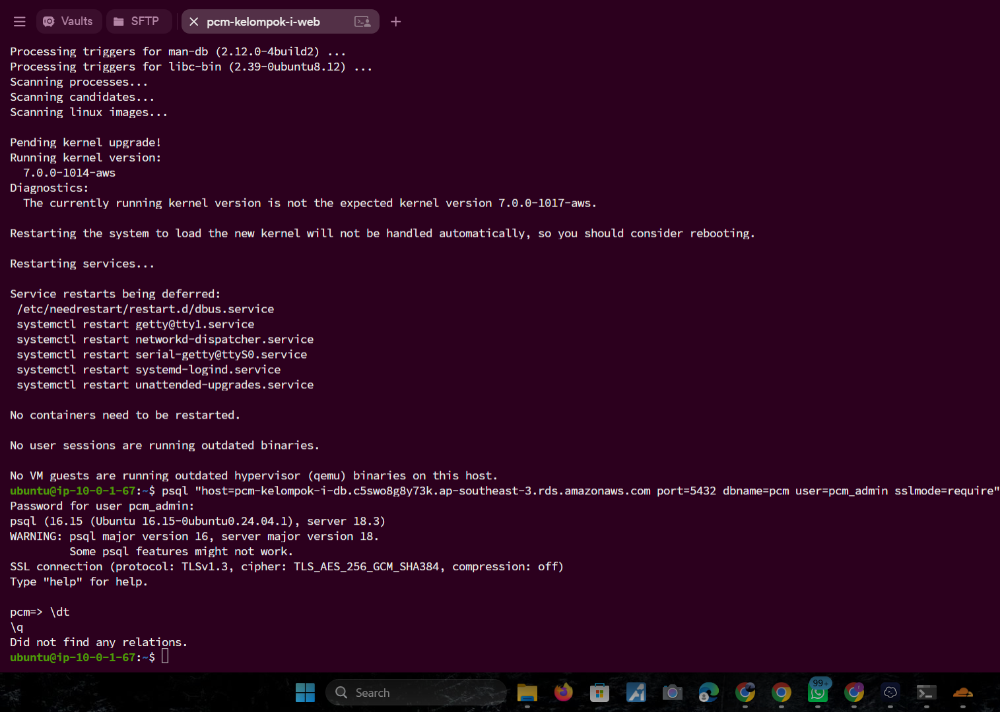 
  <em>Gambar L3.4.1: Koneksi psql dari EC2 ke RDS dengan SSL (TLSv1.3), database masih kosong.</em>

## Langkah 5: Ekspor Data dari SQLite

Ekspor dilakukan di EC2 selagi `.env` masih mengarah ke SQLite. File `db.sqlite3` dicadangkan lebih dulu ke `db.sqlite3.bak`. Setelah itu data diekspor dengan `manage.py dumpdata --natural-foreign --natural-primary` ke file `data.json`, dengan pengecualian `contenttypes`, `auth.permission`, `admin.logentry`, dan `sessions`. Tabel yang dikecualikan akan dibuat ulang otomatis oleh `migrate`, sehingga mengimpornya dari dump justru bisa bentrok dengan data yang sudah dibuat otomatis. Opsi *natural key* dipakai supaya relasi antar data tidak bergantung pada nomor ID. Isi `data.json` mencakup user, halaman, berita, agenda, dan pesan kontak.

## Langkah 6: Mengalihkan Django ke PostgreSQL dan Mengimpor Data

File `.env` dicadangkan ke `.env.level2.bak`, lalu ditambahkan satu baris `DATABASE_URL=postgres://pcm_admin:<PASSWORD>@<ENDPOINT>:5432/pcm?sslmode=require`. Password sengaja tidak ditampilkan di laporan. Parameter `sslmode=require` memaksa koneksi memakai enkripsi TLS. Setelah itu dijalankan tiga perintah berikut:

1. `uv run python manage.py migrate` untuk membuat semua tabel di RDS.
2. `uv run python manage.py loaddata data.json` untuk mengimpor data dari SQLite.
3. `sudo systemctl restart pcm` supaya Gunicorn membaca `.env` yang baru.

Perintah `seed_pcm` tidak dijalankan ke RDS karena konten contoh sudah ikut terbawa di dalam `data.json`. Menjalankannya lagi hanya akan menimbulkan data ganda atau galat *duplicate key*.

Hasilnya dicek langsung dari `psql`. Perintah `\dt` menampilkan 19 tabel milik `pcm_admin` pada skema `public`, terdiri dari tabel `auth_*` dan `django_*` bawaan Django serta sembilan tabel aplikasi `website_*` (branch, contactmessage, document, event, institution, leader, post, relatedlink, dan siteprofile) seperti pada Gambar L3.6.1.

  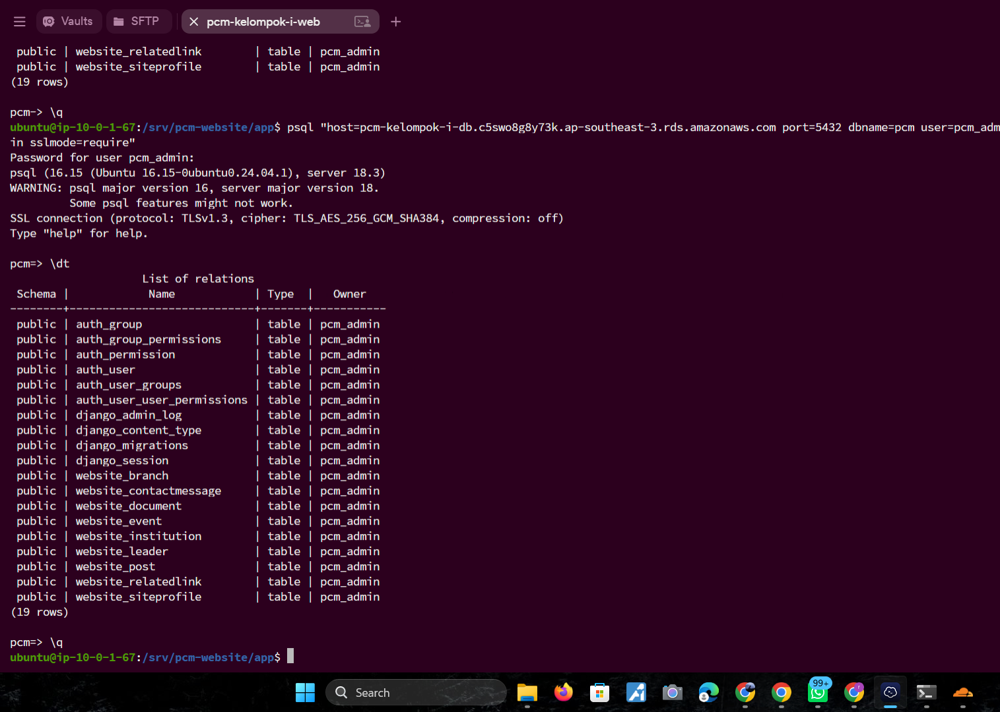 
  <em>Gambar L3.6.1: Daftar 19 tabel di RDS setelah migrate dan loaddata.</em>

Dua query singkat memastikan data lama benar-benar ikut pindah. `SELECT COUNT(*) FROM website_contactmessage` menghasilkan **3** baris pesan kontak, dan `SELECT username FROM auth_user` menampilkan akun **admin** (Gambar L3.6.2).

  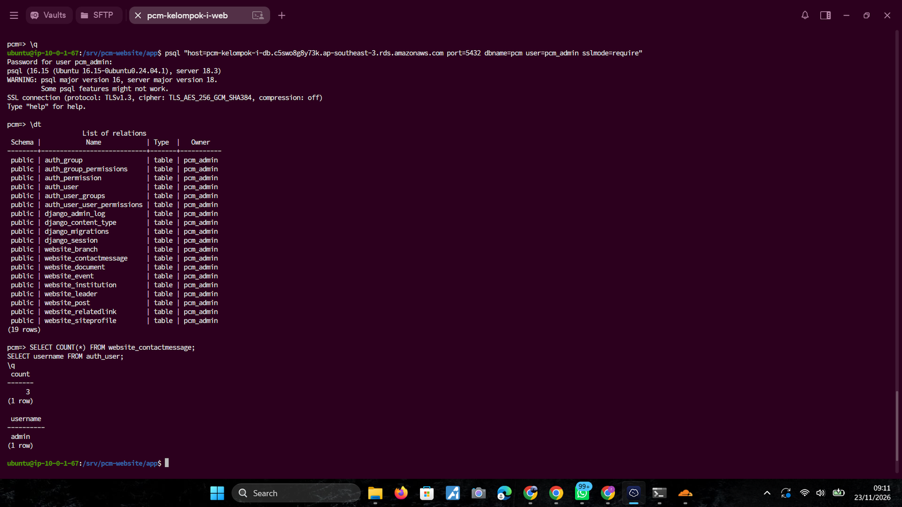 
  <em>Gambar L3.6.2: Query di RDS, tiga pesan kontak dan user admin ada di database.</em>

Pada Gambar L3.6.3, `showmigrations website` menunjukkan kedua migrasi aplikasi (`0001_initial` dan `0002_relatedlink`) berstatus `[X]` atau sudah diterapkan. Status service `pcm` tetap *active (running)* dan *enabled* dengan 3 worker Gunicorn pada `127.0.0.1:8000`. Di bagian bawah log tampak satu request dari luar dengan header Host asing (`api.hyperunit.xyz`) yang ditolak dengan kode 400 karena tidak terdaftar di `ALLOWED_HOSTS`. Ini bukan galat aplikasi, justru menunjukkan `ALLOWED_HOSTS` bekerja menolak host yang tidak dikenal.

  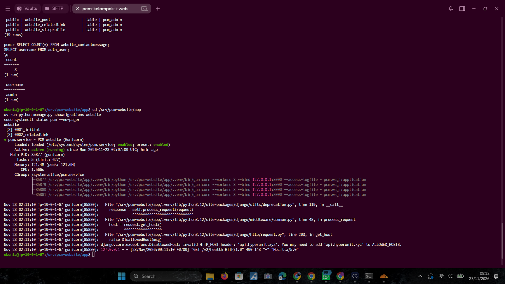 
  <em>Gambar L3.6.3: Status migrasi aplikasi dan service pcm yang berjalan di atas PostgreSQL.</em>

## Langkah 7: Verifikasi

**a. Halaman status.** Halaman `/status/` menampilkan **Level 3 terdeteksi**. Bagian *Server* menunjukkan hostname `ip-10-0-1-67`, instance ID `i-07ec4ff3770bec377`, tipe `t3.micro`, Availability Zone `ap-southeast-3a`, dan DEBUG bernilai `False`. Bagian file statis dan media masih menunjukkan `S3Storage` dengan bucket `pcm-kelompok-i-assets`. Bagian *Database* kini menunjukkan engine `postgresql`, nama `pcm`, dan host `pcm-kelompok-i-db.c5swo8g8y73k.ap-southeast-3.rds.amazonaws.com` dengan keterangan *Amazon RDS* (Gambar L3.7.1).

  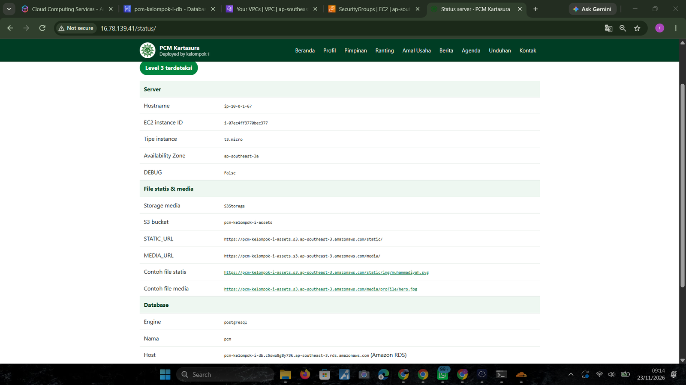 
  <em>Gambar L3.7.1: Halaman /status/ yang menunjukkan Level 3 terdeteksi dan database PostgreSQL di RDS.</em>

**b. Data dari Level 1 masih ada.** Login ke admin Django berhasil memakai username dan password yang sama seperti sebelum migrasi, artinya akun admin ikut terpindah. Menu *Pesan masuk* menampilkan tiga pesan kontak, termasuk pesan yang dikirim pada 23 Oktober 2026 (Gambar L3.7.2). Beranda website tetap tampil normal dengan tagline *Deployed by kelompok-i* di header (Gambar L3.7.3).

  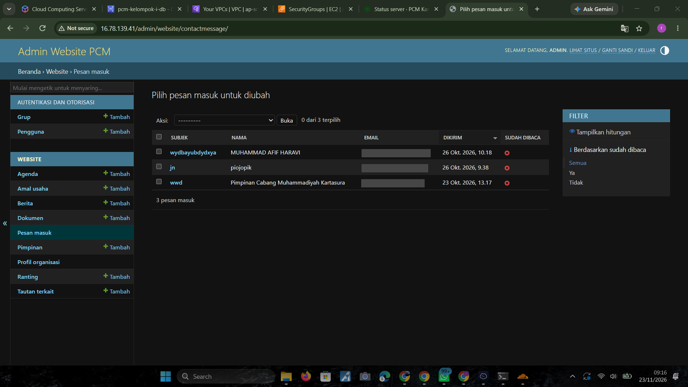 
  <em>Gambar L3.7.2: Daftar Pesan masuk di admin, tiga pesan dari Level 1 masih ada.</em>

  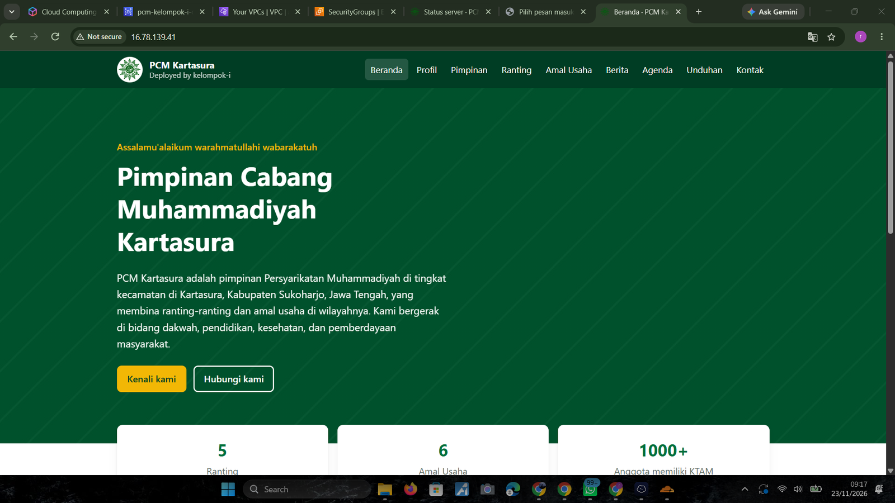 
  <em>Gambar L3.7.3: Beranda website dengan tagline Deployed by kelompok-i setelah pindah ke RDS.</em>

**c. Database tidak bisa diakses dari internet.** Pengujian dilakukan dari laptop anggota yang berada di luar VPC memakai PowerShell. Percobaan `nslookup` pertama gagal karena server DNS jaringan lokal tidak menjawab (*DNS request timed out*). Percobaan kedua dijawab dan menghasilkan alamat **10.0.12.34**. Alamat ini berada di rentang `private-b` (10.0.12.0/24), yaitu alamat privat, bukan alamat publik. Setelah itu `Test-NetConnection` ke endpoint pada port 5432 menghasilkan `TcpTestSucceeded : False` dan `PingSucceeded : False` (Gambar L3.7.4). Jadi database memang tidak terjangkau dari luar VPC.

  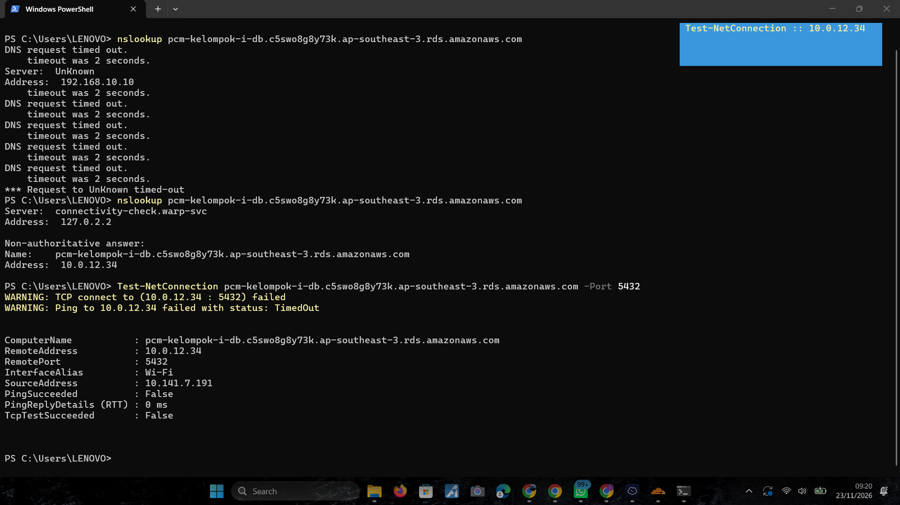 
  <em>Gambar L3.7.4: Dari laptop, endpoint RDS hanya menghasilkan IP privat 10.0.12.34 dan koneksi port 5432 gagal.</em>

## Ringkasan Bukti Level 3

Tabel berikut memetakan setiap bukti yang diminta pada panduan Level 3 ke gambar di laporan ini.

| **No** | **Bukti yang diminta**                                                                                  | **Gambar**        |
|--------|---------------------------------------------------------------------------------------------------------|-------------------|
| 1      | Tab *Connectivity & security* RDS (endpoint, VPC, subnet group, Publicly accessible No, security group) | L3.3.2 dan L3.3.3 |
| 2      | DB subnet group dengan dua subnet privat di dua AZ                                                      | L3.2.1            |
| 3      | Inbound rules `pcm-kelompok-i-db-sg`                                                                    | L3.1.1            |
| 4      | Sesi `psql` dari EC2 tanpa password terlihat, menjalankan `\dt`                                         | L3.4.1 dan L3.6.1 |
| 5      | Halaman `/status/` Level 3                                                                              | L3.7.1            |
| 6      | Daftar *Pesan masuk* yang memuat pesan dari Level 1                                                     | L3.7.2            |
| 7      | Terminal laptop yang menunjukkan IP privat dan koneksi gagal                                            | L3.7.4            |

## Pertanyaan dan Jawaban

### 1. RDS di subnet privat dan Public access No

**Pertanyaan:** Mengapa RDS diletakkan di subnet privat dengan *Public access: No*? Bagaimana EC2 bisa mengaksesnya, dan mengapa laptop Anda tidak bisa?

Database menyimpan data yang sensitif, misalnya akun admin dan pesan dari pengunjung, jadi tidak seharusnya punya jalur langsung dari internet. Ada dua lapisan pengamannya. Pertama, subnet `private-a` dan `private-b` memakai route table yang hanya berisi route `local`, sehingga tidak ada jalur ke Internet Gateway. Kedua, *Public access: No* membuat RDS tidak diberi IP publik, dan nama endpoint-nya hanya diterjemahkan menjadi IP privat. Dengan begitu serangan dari internet tidak punya target yang bisa dijangkau.

EC2 bisa mengakses RDS karena keduanya berada di VPC yang sama sehingga lalu lintasnya lewat route `local` (dari 10.0.1.67 ke 10.0.12.34). Selain itu `db-sg` secara khusus mengizinkan port 5432 dari `web-sg` yang dipakai instance EC2. Laptop berada di luar VPC. DNS memang mengembalikan 10.0.12.34, tetapi alamat privat itu tidak bisa dirutekan lewat internet, dan seandainya bisa pun `db-sg` tidak mengizinkan sumber selain `web-sg`. Hal ini terbukti pada Gambar L3.7.4 saat `Test-NetConnection` gagal.

### 2. web-sg sebagai source pada db-sg

**Pertanyaan:** Mengapa rule `db-sg` memakai `web-sg` sebagai source, bukan IP privat EC2?

Dengan security group sebagai source, artinya rule berlaku untuk instance mana pun yang memiliki `web-sg`, apa pun alamat IP-nya. IP privat EC2 (10.0.1.67) bisa berubah kalau instance diganti dengan yang baru, dan rule berbasis IP harus diedit tiap kali itu terjadi. Jika nanti ada web server kedua, rule yang memakai `web-sg` langsung berlaku tanpa diubah. Cara ini juga lebih sempit daripada mengizinkan seluruh subnet 10.0.1.0/24, karena resource lain di subnet itu yang tidak memakai `web-sg` tetap ditolak.

### 3. Pekerjaan yang diambil alih RDS

**Pertanyaan:** Sebutkan dua hal yang dikerjakan RDS untuk Anda, yang harus Anda kerjakan sendiri jika menginstal PostgreSQL di EC2.

Pertama, **backup otomatis**. RDS menjalankan backup harian dan menyimpan log transaksi sehingga database bisa dipulihkan ke titik waktu tertentu, dan retensinya cukup diatur di konsol. Kalau memasang PostgreSQL sendiri di EC2, kami harus menyusun jadwal `pg_dump` atau pengarsipan WAL, menyimpannya di tempat yang aman, lalu menguji proses restore-nya. Kedua, **patching dan pemeliharaan**. RDS mengurus pembaruan minor engine PostgreSQL dan sistem operasinya pada jendela maintenance, sedangkan di EC2 kami harus memperbarui paket, merestart layanan, dan memastikan database tidak rusak sendiri. Sebagai tambahan, sertifikat TLS (CA `rds-ca-rsa2048-g1`) juga sudah disediakan sehingga `sslmode=require` bisa langsung dipakai tanpa membuat sertifikat sendiri.

### 4. Apakah EC2 sudah stateless

**Pertanyaan:** Setelah level ini, apakah instance EC2 sudah "stateless"? Apa saja yang dibutuhkan untuk menjalankan website di instance yang benar-benar baru?

Dari sisi data, ya. File statis dan media ada di S3, sedangkan database ada di RDS, sehingga kalau instance di-*terminate* tidak ada data website yang ikut hilang. Instance hanya menjalankan kode. Satu catatan, file `.env` masih tersimpan di dalam instance, jadi salinannya perlu disimpan di tempat yang aman.

Untuk menjalankan website di instance baru, yang dibutuhkan adalah sebagai berikut.

1. Instance EC2 di VPC `pcm-kelompok-i-vpc` pada subnet publik, dengan security group `web-sg` dan IAM role `pcm-kelompok-i-ec2-s3-role` terpasang. `web-sg` penting agar `db-sg` mengizinkan koneksi, sedangkan IAM role penting agar bisa menulis ke S3.
2. Paket `nginx`, `git`, dan `uv`, lalu kode di-clone ke `/srv/pcm-website` dan dependensi dipasang dengan `uv sync --frozen`.
3. File `.env` yang sama, berisi `SECRET_KEY`, `ALLOWED_HOSTS`, `CSRF_TRUSTED_ORIGINS`, pengaturan S3, dan `DATABASE_URL`.
4. Service `pcm.service` untuk Gunicorn dan konfigurasi Nginx `pcm.conf`.
5. Elastic IP dipindahkan ke instance baru supaya URL publik tidak berubah.

Langkah `migrate`, `loaddata`, `seed_pcm`, dan `collectstatic` tidak perlu diulang karena tabel dan datanya sudah ada di RDS, dan file statisnya sudah ada di S3.

## Kesimpulan

Database website PCM berhasil dipindahkan dari SQLite di EC2 ke Amazon RDS for PostgreSQL `pcm-kelompok-i-db` yang berada di subnet privat dengan *Publicly accessible: No*. Security group `pcm-kelompok-i-db-sg` hanya mengizinkan port 5432 dari `web-sg`, koneksi aplikasi memakai `sslmode=require` (TLS 1.3), dan pengujian dari laptop membuktikan database tidak bisa dijangkau dari internet. Seluruh data Level 1, yaitu akun admin dan tiga pesan kontak, ikut pindah ke RDS, dan halaman `/status/` sudah menunjukkan **Level 3 terdeteksi**. Dengan file di S3 dan data di RDS, instance EC2 tidak lagi menyimpan state sehingga bisa diganti kapan saja tanpa kehilangan data.

---

[← Level 2](level-2-s3-iam.md) · [README](../README.md) · [Galeri bukti](../evidence/README.md) · [Selesai: kembali ke README →](../README.md)
